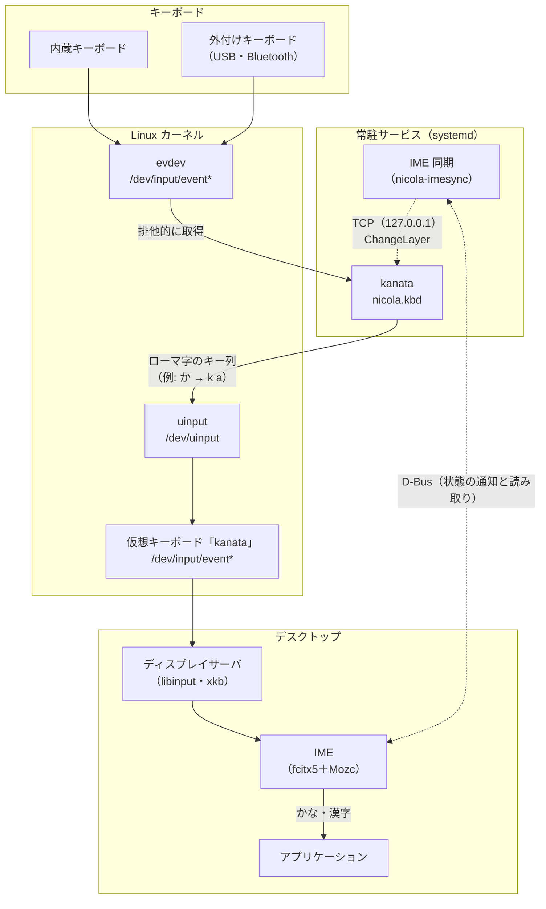
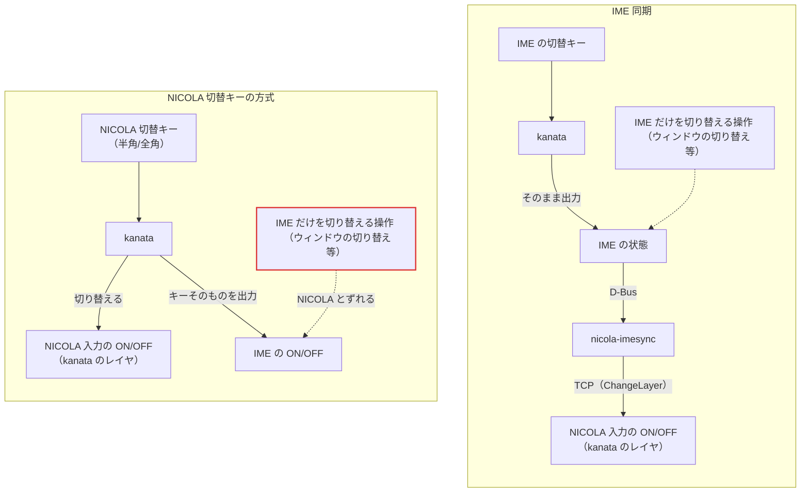
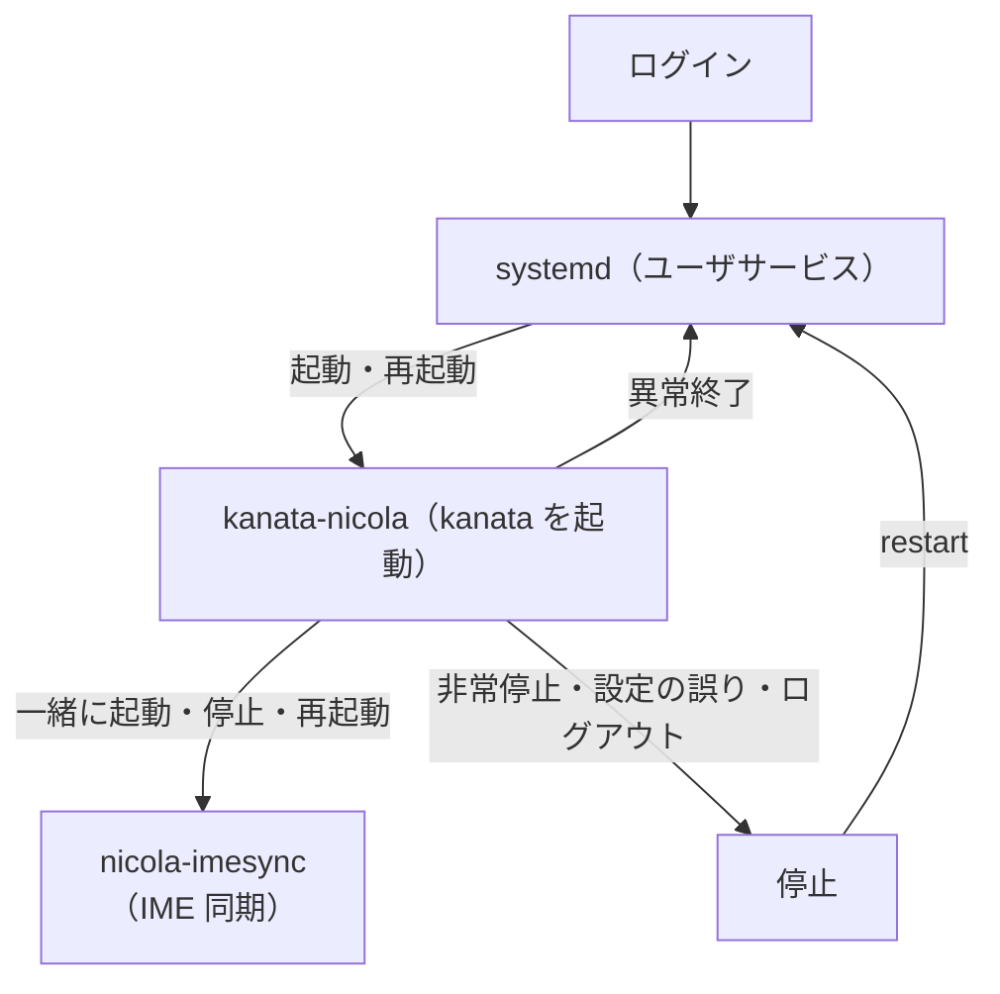

# kanata-nicola 設計書

この文書は、kanata-nicola の方式と構成を、その理由・制約とともに説明する。各コンポーネントの実装は[実装仕様書](implementation.md)、生成する kanata の設定ファイルの仕組みは[kanata の設定ファイルの設計](kanata-kbd-design.md)にある。

---

## 1. 概要

### 1.1 kanata-nicola

kanata-nicola は、キー割り当てツール [kanata](https://github.com/jtroo/kanata) の設定だけで、親指シフト（NICOLA）の日本語入力を実現するソフトウェアである。中心となるのは、次の 2 つのプログラムである（ほかの構成要素と、それぞれの役割は [§4.1](#41-構成)）。

- kanata 設定生成器（`nicola-kbdgen`）
- IME 同期（`nicola-imesync`）

**NICOLA 規格の判定には準拠しない。** 親指キーを Shift キーと同じように使う、親指先行方式を採る（規格との違いと理由は [§3](#3-nicola-規格との違い)）。規格に準拠した判定は、NICOLA 判定エンジン（別途開発、現時点では未公開。[§1.2](#12-用語)）が担う。

### 1.2 用語

**入力の用語**（親指シフト入力に関して一般のもの）:

| 用語 | 意味 |
|---|---|
| 文字キー | 配列で文字を割り当てたキー（Q〜`/` の 3 段と、数字段の一部） |
| 親指キー | 文字キーと組み合わせてシフト面を選ぶキー（既定は 左＝無変換、右＝変換。設定により変更可） |
| 単独面（本書での呼び方）・シフト面 | 文字キーだけで入力される文字の面と、親指キーと組み合わせて入力される文字の面（シフト面は、親指の面ともいう） |
| 同時打鍵 | 文字キーと親指キーを組み合わせる操作 |
| 親指先行・文字先行（本書での呼び方） | 親指キーを先に押す同時打鍵と、文字キーを先に押す同時打鍵 |
| 親指の単独打鍵 | 親指キーだけを押して離す操作（親指キーそのものを送出する） |
| 連続シフト | 親指キーを押している間の文字キーを、すべてシフト面にすること（NICOLA 規格には無い拡張。[§5.2](#52-連続シフト)） |
| 離し遅れ（本書での呼び方） | 親指キーを離すのが遅れ、次の文字まで誤ってシフト面になること |

**kanata-nicola に固有の用語**:

| 用語 | 意味 |
|---|---|
| NICOLA 入力 | 文字キーと親指キーの入力を判定し（[§5](#5-判定方式)）、配列の文字を送出する（[§7](#7-送出)）こと。ON/OFF を切り替えられ、OFF の間はキーをそのまま出力する（[§8](#8-nicola-入力の-onoff)）。文中では「NICOLA が ON」のように略す |
| NICOLA 切替キー | NICOLA 入力の ON/OFF を切り替えるキー（既定は半角/全角）。キーそのものも出力し、IME の ON/OFF も一緒に切り替える（NICOLA 切替キーの方式。[§8.1](#81-切り替えの方式)） |
| 送出 | kanata が、入力する文字の代わりに IME にキーを送ること。そのキーの並び（`か` の場合は `k a`）を送出のキー列という（[§7](#7-送出)） |
| 配列プロファイル | kanata 単体で使うときに、kanata に指定する設定ファイル（[kanata の設定ファイルの手引き §1.2](kanata-kbd.md#12-生成済みの設定ファイル)） |
| 配列差分ファイル | 標準配列のうち、変更する面だけを記述したファイル（[配列差分ファイル](layout-overlays.md)） |
| 環境固有設定 | kanata 単体で使うときの、利用環境に固有の設定（対象にするキーボード等）を記述する kanata の設定ファイル（[kanata の設定ファイルの手引き §2.1](kanata-kbd.md#21-環境固有設定user-customkbd)） |
| 非常停止 | キーが意図しない動作をするときに、kanata を停止して、キーボードを取り戻す操作（左Ctrl+Space+Esc。kanata の標準。[§9](#9-常駐)） |
| NICOLA 判定エンジン | NICOLA 規格に準拠した判定を行うソフトウェア（別途開発、現時点では未公開） |

### 1.3 ID

本書では、プロジェクト全体で共通の ID を使う。

| ID | 意味 |
|---|---|
| `ADR-xx` | 設計判断の記録（Architecture Decision Record）。kanata-nicola に固有の判断の本文は [§11](#11-設計判断) |
| `OQ-xx` | 未確定事項・未解決の課題（Open Question）。kanata-nicola に関係するものは [§12](#12-既知の制限と未解決事項) |
| `TC-xx` | テストケース。`TC-Pxx` は親指先行方式のケース（`testdata/kanata_prefix_cases.toml`） |
| `D-xx` | NICOLA 規格の資料間の差異（例: D-10 は濁点・半濁点の面の違い） |

番号は、NICOLA 判定エンジン（[§1.2](#12-用語)）を含むプロジェクト全体の通し番号である。そのため、本書で使う番号は連続しない。ID は変更せず、再利用しない。

---

## 2. 設計の方針

設計では、次のことを重視する（両立しない場合は、上を優先する）。

1. **安定:** どのアプリケーションでも同じように入力できる。長期間の連続稼働でも停止せず、キーの状態が実際の操作と食い違わない。入力が意図どおりにならないときも、非常停止でキーボードを取り戻せる（[§8](#8-nicola-入力の-onoff)・[§9](#9-常駐)・[§10.1](#101-使用するバージョンと修正)）。
2. **性能:** 入力が遅れず、常駐しても CPU・メモリの負荷が低い（負荷は E2E で測る。[実装仕様書 §6.3](implementation.md#63-e2e)）。
3. **互換性:** バージョンアップ時も、入力の動作を変わらず保つ（kanata のバージョンを固定し、期待する動作をシミュレーションと E2E で確かめる）。
4. **設定の容易さ:** 親指キーや対象にするキーボードなど、利用環境に応じた設定は、設定ファイル（`config.env`）で指定できる。kanata の設定ファイル（`.kbd`）の直接編集は必要なく、バージョンアップ時にも設定は維持される。
5. **移植性:** OS に依存する部分と依存しない部分を分離し、ほかの OS への移植性を確保する（[§4.1](#41-構成)）。

NICOLA 規格への厳格な準拠よりも、上の方針を優先する（規格との違いは [§3](#3-nicola-規格との違い)）。

---

## 3. NICOLA 規格との違い

NICOLA 規格（NICOLA 配列規格書・JIS 提案・実装情報）と kanata-nicola の対応は、次のとおり。配列（J 型）と、親指キーを先に押す同時打鍵は、規格どおりに入力できる。主な違いは、文字キーを先に押す同時打鍵が成立しないことと、連続シフトである（理由は [§3.1](#31-規格と異なる方式にしている理由)）。

表の「対応」の記号は、○ が規格と同じもの、△ が規格と異なる形で対応するもの、× が対応しないもの。

| 項目 | NICOLA 規格 | 対応 | kanata-nicola（親指先行方式） | 詳細 |
|---|---|---|---|---|
| 配列 | J 型・F 型・A 型と、小指シフトの面を定める | ○（J 型）・×（F 型・A 型、小指シフト） | J 型は規格どおりに配置する（数字段の一部の記号を除く）。ただし、`゛` `゜` だけの面は送出できず、`，`・`．` は `、`・`。` と区別できない（ローマ字の送出の制約。[§7.1](#71-ローマ字方式)）。F 型・A 型と小指シフトの面は未対応 | [§6.1](#61-標準配列nicola-j型) |
| 親指先行の同時打鍵（親指→文字） | 判定時間内の場合は同時打鍵 | ○ | 同時打鍵（時間の制限なし。規格書 §6.1 の緩慢な打鍵への配慮も満たす） | [§5.1](#51-親指先行方式) |
| 文字先行の同時打鍵（文字→親指） | 判定時間内の場合は同時打鍵（3キー判定・薄い重なり判定で組を決める） | × | **成立しない**（文字は単独面、親指は単独打鍵）。そのため、判定時間・3キー判定・薄い重なり判定は使用しない | [§5.1](#51-親指先行方式) |
| 親指を押している間の文字 | 1 文字目だけ同時打鍵（次の文字は、親指を押したままでも単独面） | △ | **すべてシフト面**（連続シフト。規格には無い拡張） | [§5.2](#52-連続シフト) |
| 文字が入力される時点 | 判定が付いたとき（キーを離す、次のキーを押す、判定時間が過ぎる） | △ | 押した瞬間 | [§5.1](#51-親指先行方式) |
| 親指の単独打鍵 | 判定時間が過ぎるか、キーを離したときに確定 | △ | 離したときに送出する（押している間に文字キーを押さなかったときだけ） | [§5.1](#51-親指先行方式) |
| 機能する範囲 | かなモードでだけ機能する | ○（IME 同期）・△（NICOLA 切替キーの方式） | IME 同期では、IME の入力モードがかな系のときだけ ON にする。NICOLA 切替キーの方式では、NICOLA 切替キーで ON/OFF する | [§8](#8-nicola-入力の-onoff) |
| 修飾キー | 同時打鍵に関与しない（小指 Shift は、文字の出力時に参照してよい） | ○（Ctrl・Alt・Super）・△（小指 Shift） | 押している間は、判定せずにキーをそのまま出力する（小指 Shift では英大文字になる。ADR-14） | [§5.3](#53-修飾キー) |
| 文字キーの長押し | キーリピートは参考として規定 | × | リピートしない（1 文字だけ入力される） | [§7.2](#72-送出の割り込み対策) |
| 一本指操作（アクセシビリティ） | 親指の単独打鍵の直後の文字も同時打鍵にする | × | 未対応 | — |

### 3.1 規格と異なる方式にしている理由

規格と異なる方式（親指先行方式。ADR-18）にしている理由は次のとおり。

- **kanata（1.12.0 まで）では規格の判定を実現できない。** 規格の 3キー判定・薄い重なり判定は、押した時刻の差やキーが重なった長さを比べて決める。kanata の同時押し（chord。`defchordsv2`）は、キーが同時に押されているかしか見ない（詳細は [§10.6](#106-規格の判定に必要な機能)）。chord で文字先行を含めて判定する方式も検証したが、3キー判定が無いため、速く入力すると、親指キーが直前の文字キーと組まれる誤判定が起きた（「ドキュメント」の「どきゅ」〔J＋左親指、K、F＋左親指〕で、F 用の左親指が K と組まれ、「どぎゅ」になる）。ロール打鍵の 2 打鍵目が同時打鍵にならない取りこぼしも起きる（[§10.2](#102-判定と送出の制約)）。
- **文字の入力が、同時打鍵の判定を待たない。** 文字は、文字キーを押した瞬間に入力される。判定時間を待って文字を確定する方式では、文字が入力されるまでの遅れを感じやすい（試作版で測定した結果では、体感の遅れの大部分は処理ではなく判定の待ちで、kanata の処理の上乗せは約 2ms だった）。
- **親指キーを Shift キーと同じように使える。** 親指キーを先に押し、押したまま文字キーを続けて押す打ち方を、そのまま受け付ける。ほかの親指シフトの実装のうち、親指キーを修飾キーとして扱うもの（[§13](#13-参考資料)）も、同じ打ち方をする。運用テスト（[§4.3](#43-動作を確認した環境)）でも、この打ち方で継続して使用できた。
- **判定の規則が単純で、調整が不要である。** 判定時間などの調整の値が無く、押下順による誤判定も起きない。

この方式の制約と、その対応方法は次のとおり。

| 制約 | 対応方法 |
|---|---|
| 文字を先に押す同時打鍵は成立しない | 親指キーを文字キーより先に押す（Shift キーと同じ打ち方） |
| 連続シフトのため、親指を離すのが遅れると次の文字がシフト面になる（離し遅れ） | 配列差分ファイル `lag-tolerant`（離し遅れの対策。[§6.2](#62-配列差分ファイルによる調整)）を使用する。標準配列と異なる配置になる（[§5.2](#52-連続シフト)） |

---

## 4. 構成と動作環境

### 4.1 構成

kanata-nicola の構成は、次のとおり（Linux の場合）。実線は、キー入力が文字になるまでの経路、点線は、IME の状態に合わせて NICOLA を切り替える経路である。

構成要素の役割と、クロスプラットフォームへの対応（[§2](#2-設計の方針) の移植性）は、次のとおり。記号は、○ が OS に依存しないもの、× が OS ごとに実装が必要なもの（現在は Linux のみサポート）。

| 構成要素 | 役割 | クロスプラットフォーム |
|---|---|---|
| kanata | キーボードを排他的に取得し、NICOLA の判定（[§5](#5-判定方式)）とローマ字への変換（[§7](#7-送出)）を行って送出する。xkb より下の層で動くため、X11・Wayland を問わない（コンソールでの使用は **未確認**） | ○ |
| kanata 設定生成器・`nicola.kbd` | 配列定義と配列差分ファイルから、kanata の設定ファイル `nicola.kbd` を生成する | ○ |
| IME | ローマ字のキー列をかなにし、かな漢字変換する（ローマ字入力のまま使用する） | ○（OS ごとの IME を使用する） |
| IME 同期（nicola-imesync） | IME（現在は fcitx5＋Mozc）の状態に合わせて、kanata のレイヤ（`nicola` / `base`）を切り替える（[§8.2](#82-ime-同期の動作)） | ×（IME の状態の読み方が OS ごとに異なる。[§8.3](#83-ime-同期の-os-ごとの実装)） |
| 常駐サービス（systemd のユーザサービス） | ログイン時に、`config.env` に従って `nicola.kbd` を生成し、kanata と IME 同期を起動する。異常終了したときは再起動する（[§9](#9-常駐)） | ×（`platform/<OS>/` に OS ごとに用意する） |

### 4.2 動作の前提

kanata-nicola の方式が前提にする環境と、その理由は、次のとおり（対象の OS・キーボード・IME と、導入に必要なものは[導入と利用 §1](usage.md#1-動作環境)）。

| 分類 | 前提 | 理由 |
|---|---|---|
| OS | Linux カーネルの evdev・uinput を使用できる（`/dev/input/*` と `/dev/uinput` への権限） | kanata は、ディスプレイサーバより下の層で、キーを取得・送出するため（[§4.1](#41-構成)） |
| キーボード | JIS 配列のキーボード（親指キーは、設定で Space・カタカナ/ひらがな等にも変更できる。[設定リファレンス §2](settings.md#2-設定項目) の `NICOLA_THUMB_KEYS`） | 既定の親指キーの無変換・変換が、US 配列などのキーボードには無く、親指キーにできるのが Space だけになるため。修飾キーは親指キーにできない（修飾キーを押している間は、文字キーをそのまま出力するため。ADR-14） |
| デスクトップの設定 | キー配列（xkb）が日本語（`jp`） | 送出のキー列は、`jp` の配列で入力される文字を前提にしているため。英語（`us`）では、数字段の親指の面の記号（`「」（）｛｝『』`）が別の文字になる（ASCII の記号を入力するキーが異なる） |
| IME | ローマ字表が Mozc 相当（IME 同期を使用する場合は、fcitx5＋Mozc） | 送出に、Mozc の既定のローマ字表のローマ字を使用するため（[§7.1](#71-ローマ字方式)）。IME 同期は、IME の状態の読み方が IME ごとに異なり、現在は fcitx5＋Mozc に対応している（ibus＋Mozc は、NICOLA 切替キーの方式で使用する。[§8.1](#81-切り替えの方式)） |
| 常駐 | systemd と、`graphical-session.target` を開始するデスクトップ環境（GNOME・KDE Plasma 等） | 常駐サービスは、systemd のユーザサービスで、グラフィカルセッションの始まりで起動するため（[§9](#9-常駐)）。開始しないデスクトップ環境やコンソールでは、手動で起動する。systemd 以外の init には対応していない |

Windows は、正式サポート前（試用は可能）である。対応の状況は[Windows での利用 §1](windows.md#1-対応の状況linux-版との比較)にある。

### 4.3 動作を確認した環境

動作を確認した環境と、確認した内容は、次のとおり。

| OS | セッション | IME | 確認した内容 |
|---|---|---|---|
| Ubuntu 24.04 | X11・Wayland | fcitx5＋Mozc | 導入、常駐、IME 同期、スリープ復帰、アンインストール |
| Ubuntu 26.04 | Wayland | fcitx5＋Mozc | 導入、常駐、IME 同期、スリープ復帰、アンインストール |
| （同上） | （同上） | ibus＋Mozc | NICOLA 切替キーの方式での入力 |

開発に使った PC では、常駐サービスで継続して使用した（運用テスト）。クラッシュ（異常終了からの再起動）は無く、スリープ復帰の後もそのまま入力でき、複数の外付けキーボード・複数のアプリケーションで動作した。例外は、リモートデスクトップで接続した場合である（[§12.3](#123-利用環境)、OQ-19）。

ビルドとテストは、上の OS のコンテナ（[導入と利用 §2](usage.md#2-導入) のパッケージだけをインストールしたもの）でも確認した。

---

## 5. 判定方式

判定方式は、親指先行方式だけである（ADR-18）。規格との違いと、この方式にしている理由は [§3](#3-nicola-規格との違い) にある。

### 5.1 親指先行方式

文字キーを押した瞬間に親指キーが押されているかだけで、シフト面か単独面かを決める。操作と結果は、次のとおり。

| 操作 | 結果 |
|---|---|
| 文字キーだけを押す | 単独面の文字を、押した瞬間に入力する |
| 親指キーを押してから文字キーを押す | その親指キーのシフト面の文字を、文字キーを押した瞬間に入力する（親指キーを押してからの時間の制限は無い） |
| 文字キーを押してから親指キーを押す | 同時打鍵にならない（文字は単独面、親指キーは単独打鍵） |
| 親指キーを押したまま複数の文字キーを押す | すべてシフト面（連続シフト。[§5.2](#52-連続シフト)） |
| 親指キーだけを押して離す | 押している間に文字キーを押さなかった場合だけ、離したときに親指キーそのものを送出する。押している間に文字キー以外のキー（Enter 等）を押した場合も送出する |
| 親指キーを押してから修飾キーを押し、修飾キーを押したまま親指キーを離す | 親指キーを送出しない。送出すると、修飾キーと親指キーの組み合わせ（Shift＋親指キー等）になり、その組み合わせに IME の操作が割り当てられている場合は、意図せずに実行されるため |
| 修飾キー（Ctrl・Alt・Super・Shift）を押しながら親指キーを押す | 親指キーをそのまま出力する（IME の操作に割り当てた組み合わせを使用できる。[§5.3](#53-修飾キー)） |

期待する動作は、テストケース TC-Pxx（[§1.3](#13-id)）で定めている。

**kanata での実現方法:** 親指キーを押している間だけ、その親指のシフト面のレイヤを一時的に有効にする。親指の単独打鍵は、押している間に文字キーを押したかを示すフラグ（仮想キー。kanata の `defvirtualkeys` で定義し、ほかの動作から押す・離すキー）を見て、離したときに送出するかを決める。定義は[kanata の設定ファイルの設計 §2.1](kanata-kbd-design.md#21-親指先行の判定)・[§2.3](kanata-kbd-design.md#23-親指の単独打鍵) にある。

### 5.2 連続シフト

連続シフト（[§1.2](#12-用語)）は、**NICOLA 規格には無い拡張**である。規格（JIS 提案の状態遷移）では、親指キーの 1 回の押下で組むのは 1 文字で、同時打鍵の文字を出力すると初期状態に戻るので、親指キーを押したままでも、次の文字は単独面になる。規格書 §6.1「緩慢な打鍵操作」も、親指キーを先に押す打鍵の時間の制限を無くすもので、連続シフトではない。

親指先行方式では、連続シフトは方式の性質として常に有効で、無効にはできない。判定は「文字キーを押した瞬間に親指キーが押されているか」だけで、それまでに入力した文字を記憶しないためである（Shift キーを押したまま英字を続けて入力するのと同じ）。

**離し遅れ（[§1.2](#12-用語)）:** 連続シフトの短所で、連続シフトを使用できる実装の多くで起きる。数字段にも親指の面があるので、数字や `ー`（`-` キー）の入力でも起きる（記号が入力される）。対策と、kanata-nicola での扱いは次のとおり。

| 対策 | kanata-nicola での扱い |
|---|---|
| 配列で吸収する（打鍵頻度の高いキーのシフト面を、単独面と同じ文字にする） | 配列差分ファイル `lag-tolerant`（[§6.2](#62-配列差分ファイルによる調整)）で対応する |
| 判定で防ぐ（親指キーの押下が次の文字キーの打鍵をどれだけ覆ったかの割合で判定する。割合判定。[§13](#13-参考資料)、OQ-14） | kanata では実現できない（[§10.2](#102-判定と送出の制約)） |
| 判定で防ぐ（親指キーの 1 回の押下で、1 文字だけをシフト面にする。規格と同じ） | kanata でも実現できる見込みだが、採らない（ADR-18） |

### 5.3 修飾キー

修飾キー（Ctrl・Alt・Super・Shift）の扱いは、次のとおり。

| 項目 | 内容 |
|---|---|
| 修飾キーを再定義しない | 修飾キーは、NICOLA が ON の間もそのまま出力する。ほかの親指シフトの実装（kanata の設定の例。[§13](#13-参考資料)）で、修飾キーを再定義したことによって、Shift が押されたままになることが観測されたため |
| 修飾キーを押している間は判定しない（ADR-14） | 修飾キーを押している間は、文字キー・親指キーを判定せず、そのまま出力する（Ctrl+W 等のショートカットと、Shift+英字の入力を妨げない） |
| Ctrl として扱うキー | kanata は xkb より下の層で動くため、xkb で Ctrl に変更した CapsLock（`ctrl:nocaps` 等）を CapsLock としか認識しない。このようなキーは `NICOLA_KEYS_AS_CTRL` で指定する。指定しない場合は、NICOLA が ON のとき、CapsLock+A が Ctrl+U（`う` のローマ字 `u` と Ctrl の組み合わせ）になる |

kanata の定義での実現は[kanata の設定ファイルの設計 §2.4](kanata-kbd-design.md#24-修飾キーとの組み合わせ) にある。

---

## 6. キーの割り当て

### 6.1 標準配列（NICOLA J型）

標準配列（`layouts/nicola-j.toml`）の主な仕様は、次のとおり。

| 項目 | 内容 |
|---|---|
| 対象のキー | 3 段（Q〜P と `@` `[`、A〜`;`、Z〜`/`）の 32 キーと、数字段（E段）の 11 キー |
| 面 | 単独面・左親指の面・右親指の面の 3 面 |
| 出典 | 3 段は NICOLA 配列規格書（2000-01-08）と 2018-11 の正誤。数字段は JIS 提案（仮名漢字変換用親指シフト型けん盤配列）の J型図 |
| 濁点・半濁点の面 | 規格書と正誤に合わせている（資料により異なる。D-10。JIS 提案の J型図には、D01 の右親指の面 `゜` と B10 の左親指の面 `゛` が無い） |
| 規格で未定義の親指の面 | 親指キーと組み合わせても、単独面の文字を入力する（ADR-15） |
| 数字段の面 | 単独面は数字、親指の面は J型図の記号（左右の親指キーで同じ）。図の `［］`（E06・E07）は `｛｝` に代えている（Mozc の既定のローマ字表に、`［］` を `「」` と区別して入力するローマ字が無いため。`［］` にする方法は[配列差分ファイル §2.1](layout-overlays.md#21-面に記述する値)）。図に無い `〜『』`（E03・E10・E11）を追加している（ほかの親指シフトの実装〔[§13](#13-参考資料)〕で共通の追加。NICOLA の実装情報は、未定義の場所への追加を認めている） |
| 小指シフトの面 | 未対応（OQ-02） |

### 6.2 配列差分ファイルによる調整

標準配列を編集せずに配置を調整するため、配列差分ファイル（[§1.2](#12-用語)）を重ねる。配列差分ファイルは、指定した順に重ねられ、それぞれ記述した面だけを置き換える（記述しない面は、前のまま残る）。

同梱の配列差分ファイルは、使用頻度による配置の調整（`practical`）と、離し遅れの対策（`lag-tolerant`。[§5.2](#52-連続シフト)。`practical` の上に重ねる）である。既定では、配列差分ファイルを使用しない（標準配列のまま）。書式と、同梱の配列差分ファイルの内容と理由は[配列差分ファイル](layout-overlays.md)にある。

**ローマ字で記述した面:** 配列差分ファイルの面には、文字（かな・記号）のほか、IME に入力するローマ字を記述できる。標準配列で入力できない文字を、利用者が IME 側のローマ字表に登録して入力するためのもの（`z6` で `［` が入力されるように登録し、面に `z6` と記述する等）で、標準配列と同梱の配列差分ファイルは使用しない。

- 面を英数字・記号（ASCII）だけで記述すると、ローマ字とみなし、記述したとおりのキーを送出する（`z*` は `z` と Shift+`:`）。送出の表（[§7.1](#71-ローマ字方式)）の文字は全角（かな・記号）で、ASCII と重ならないため、文字とローマ字は値だけで区別できる。
- 面には文字（`［`）を記述し、利用者がその文字のローマ字（`z6`）を送出の表に追加する方式は採らない。`［` と `z6` の対応を、IME 側のローマ字表と、kanata-nicola 側の送出の表の 2 か所に記述することになるため（ローマ字で記述すれば、IME 側のローマ字表への登録だけで済む）。
- 記述できるローマ字の制約は[配列差分ファイル §2.2](layout-overlays.md#22-記述できない値)にある。

**送出できない面:** kanata 設定生成器は、送出の表に無い文字と、記述できないローマ字をエラーにする（`゛` `゜` だけの面を除く。[§7.1](#71-ローマ字方式)）。

- 理由: キーをそのまま出力すると、意図と異なる文字が、エラーにならずに入力される（D12 の面に `［` と記述すると、D12 は JIS の `[` キーなので `「` が入力される）。
- エラーのメッセージには、文字コードを含める。見た目が同じ別の文字（全角チルダ `～`〔U+FF5E〕と波ダッシュ `〜`〔U+301C〕、全角の英字等）を見分けられるようにするため。
- Unicode の正規化（結合文字の濁点を 1 文字にまとめる等）はしない。正規化で解消できるのは結合文字の形だけで、エラーで気づいて修正できるため。

### 6.3 文字キー以外のキーの再割り当て

kanata-nicola の kanata はキーボードを排他的に取得するため、同じキーボードに、別の kanata の設定を併用できない。そこで、文字キー以外のキーの再割り当て（配列で使わないキーを、キーボードに無いキー〔Menu キー等〕として使う等）は、利用者が kanata の書式で記述したファイルを、kanata-nicola が生成する kanata の設定ファイルに `include` で読み込んで行う（設定 `NICOLA_EXTRA_KBD`。書式と例は[設定リファレンス §3.2](settings.md#32-追加の-kanata-の設定ファイル)）。

この方式の要点と、その理由は次のとおり。

| 要点 | 理由 |
|---|---|
| 再割り当てには、kanata の `defoverrides`（出力するキーを、別のキーに置き換える定義）を使用する | どの動作から出力されたキーでも置き換えるので、生成する設定ファイルの `defsrc`（扱うキーを並べる kanata の定義）やレイヤを変更せずに、NICOLA の ON/OFF によらず有効になる。生成する設定ファイルは `defoverrides` を使用しない（kanata は 1 つの設定に 1 つしか認めない） |
| 文字キーの再割り当て（長押しで別の動作をさせる等）は扱わない | NICOLA の判定と競合する |
| 配列差分ファイルに、キーの再割り当ての書式を設けない | kanata 設定生成器の変更とテストが大きくなる。kanata の利用者には、知っている書式で記述できる方が分かりやすい |

---

## 7. 送出

### 7.1 ローマ字方式

判定した文字（かな・記号）を、IME のローマ字入力のキー列として送出する（例: `か` → `k a`、`ゃ` → `x y a`、`ん` → `x n`）。IME はローマ字入力のまま使用する。文字ごとのキー列は、kanata 設定生成器の送出の表（文字ごとの送出のキー列の表）で決める。

**ローマ字方式にしている理由（ADR-17）:** かな直接方式（IME をかな入力モードにする方式）では、IME が ON の間、数字・記号のキーにもかなが割り当てられる（JIS のかな配列。`1` は `ぬ`）。そのため、数字・記号を交えて入力する作業（プログラミング等）では、入力モードの切り替えが頻繁に発生する。

ローマ字入力で送出するため、次の制約がある。

- 記号は、Mozc の既定のローマ字表で入力できるものに限る（`→` は `z l` 等）。z＋キーのローマ字は Mozc 系の IME のもので、Microsoft IME には無い（[Windows での利用 §3](windows.md#3-制約と注意)）。
- 同じキーで入力する文字（`、` と `，`、`。` と `．`、`・` と `／`）は、区別して送出できない。どちらが入力されるかは、IME の設定（句読点、記号の入力）で決まる（既定は `、`・`。`・`・`）。`・` を Mozc 系のローマ字 `z/` で送出しないのは、Microsoft IME のローマ字表に `z/` が無いためである（記号の入力を `「」／` にして `・` を残す場合は、配列差分ファイルで B10 の単独面にローマ字 `z/` を記述する）。
- 濁点・半濁点（`゛` `゜`）だけの入力は、送出できない（OQ-10）。`゛` `゜` だけの面は標準配列にあるので、エラーにせず、キーをそのまま出力する。

### 7.2 送出の割り込み対策

1 文字を複数のキーで送出するとき、その途中にほかのキー（Enter、Ctrl、次の文字）が割り込むと、送出が崩れる。kanata の `macro` は 1 キーずつ順に送出するため、次の問題が起きる。

| 起きる問題 | 例 |
|---|---|
| Enter が、文字の送出より先に出力される | `さ` を入力した直後に Enter を押す |
| Ctrl が割り込み、ショートカットになる | `さ` の `s` と `a` の間に Ctrl が入り、Ctrl+A（全選択）になる |
| 2 文字の送出のキー列が混ざる | ロール打鍵（前の文字キーを離す前に、次の文字キーを押す） |

対策は、次のとおり（kanata の定義での実現は[kanata の設定ファイルの設計 §2.2](kanata-kbd-design.md#22-送出の原子性)）。tick は、kanata が処理を進める 1ms の単位である。

| 対策 | 内容 |
|---|---|
| 1 文字のキーを同時に押す | 1 文字の全キーを、判定した tick で同時に押し、次の tick で離す。Enter・Ctrl・Shift は常に文字の後に出力され、文字キーを長押ししてもオートリピートしない |
| 出力中のキーは押し直す | 押すキーが出力中の場合（ロール打鍵で、直前の文字と同じキーを使う場合）は、その tick で離し、次の tick で押し直す |
| 1 文字の中で同じキーを使わない | `ん` は、`n n` ではなく `x n` で送出する |
| Shift の出力中は待つ | Shift を押す文字（数字段の `？｛｝（）`、ローマ字で記述した面の `z*` 等。[§6.2](#62-配列差分ファイルによる調整)）は、Shift もほかのキーと同じ tick で押す。その間に次の文字を送出すると、Shift と組み合わせて出力される（`か` が `K A` になる。ほぼ同時に押した 2 つのキーが、キーボードの 1 回の報告で届いた場合など）。そのため、Shift を押す文字がある配列（標準配列を含む）では、Shift が離されるのを待ってから次の文字のキーを押す。文字キー以外のキー（Enter・Space 等）は、kanata がそのまま出力するので、この待ちが及ばない（[§12.1](#121-入力の動作)） |

ランダムな高速打鍵（1000 件）で、判定した文字と送出した文字が食い違ったものは、`macro` で送出した場合は 54.1% だった。対策の後は 0 件である（シミュレーションで確かめている。[実装仕様書 §6.2](implementation.md#62-シミュレーション)）。

検証して採らなかった案は、次のとおり。

| 案 | 採らなかった理由 |
|---|---|
| 同じ tick で押すだけにする（離さない） | 物理キーを離すまで押されたままになり、オートリピートする。ロール打鍵で共通の母音が消える |
| 仮想キーを経由して押す | 1 tick 遅れるため、Enter・Ctrl が文字より先に出力される |
| 送出のキーのどれかが出力中の場合は、その文字のキーをすべて遅らせて押す | 遅らせた文字より後の文字が先に出力され、送出の崩れが残った |

**残る可能性:** 直前の文字と同じキー（ローマ字では、母音を多くの文字で共有する）をまだ出力しているうちに次の文字キーを押すと、押し直しを待つ文字より後の文字が先に送出され、順序が入れ替わる可能性がある。kanata には送出を順番に並べる仕組みが無く、設定だけでは解消できない（ランダムな打鍵 1000 件では起きない。運用テストでも確認されていない）。

---

## 8. NICOLA 入力の ON/OFF

### 8.1 切り替えの方式

NICOLA 入力（[§1.2](#12-用語)）の ON/OFF を切り替える方式は、次の 2 つである。

| 方式 | 設定 | 内容 |
|---|---|---|
| IME 同期（推奨） | `NICOLA_IME_SYNC=1` | IME の実際の状態に合わせて切り替える（[§8.2](#82-ime-同期の動作)）。IME の切替キーは、そのまま出力する |
| NICOLA 切替キーの方式 | `NICOLA_IME_SYNC=0`（既定） | NICOLA 切替キーを押すと、キーそのものの出力に加えて、NICOLA も切り替える |

2 つの方式で、IME と NICOLA の状態が伝わる経路は、次のとおり（構成要素の全体は [§4.1](#41-構成)）。破線は、IME の状態だけを変える操作で、NICOLA 切替キーの方式では NICOLA に伝わらない。

**NICOLA 切替キーの方式の限界:** この方式は、IME の実際の状態を参照しない。そのため、一方だけが切り替わることが一度でも起きると、以後は IME と NICOLA の状態が逆になる（IME が OFF で、NICOLA が ON 等）。状態が食い違う原因は、次のとおり。

| 原因 | 内容 |
|---|---|
| ウィンドウの切り替え | fcitx5 の `ShareInputState=No`（fcitx5 の既定）では、IME の ON/OFF がウィンドウごとに異なるため、IME の状態だけが変わる |
| Mozc の入力モードの切り替え | Mozc にも「直接入力」の状態があり、ひらがな・カタカナ・英数・漢字キー等で切り替わる |
| マウス・トレイからの切り替え、アプリケーションによる切り替え（エディタが入力のモードを終えるときに IME を OFF にする等） | IME の状態だけが変わる |
| kanata の起動時に IME が ON | 起動の時点から逆になる |

IME の状態は、fcitx5 で選択されている入力メソッドと、Mozc の入力モードの二層になっているため、NICOLA 切替キーの方式では原理的に揃えられない。

kanata の定義（NICOLA 切替キーと、IME 同期で切り替えるレイヤ）は[kanata の設定ファイルの設計 §2.5](kanata-kbd-design.md#25-nicola-入力の-onoff) にある。

### 8.2 IME 同期の動作

nicola-imesync は、ユーザセッションで動作し、fcitx5 の状態を D-Bus で読み取り、kanata の TCP ポート（[§10.5](#105-tcp-ポート)）にレイヤの切り替え（`ChangeLayer`）を送信する。NICOLA をキーで切り替えることはしない（IME の切替キーは、そのまま fcitx5 に届く）。fcitx5 への問い合わせには、D-Bus の自動起動を使用しない（利用者が終了した fcitx5 を起動しないため）。読み取る D-Bus のインタフェースと、オプション・ログは[実装仕様書 §4](implementation.md#4-ime-同期nicola-imesync)にある。

NICOLA は、次の条件をすべて満たすときに ON にする。

1. 入力欄にフォーカスがある
2. 入力メソッドが Mozc である
3. Mozc の入力モードがかな系（ひらがな・カタカナ）である（直接入力・英数では OFF）

fcitx5 の「有効・無効」は条件にしない。fcitx5 は、現在の入力メソッドが一覧の先頭でないときを「有効」とするため、Mozc を先頭に置く設定では、Mozc を使用している間が「無効」になる。上の条件は、入力メソッドの並びによらず、現在の入力メソッドとその入力モードで決まる。

fcitx5 には、Mozc の入力モードを返す公式の API が無い。そのため、Mozc の入力モードは、fcitx5 が表示用に送信する情報から読み取る。読み取る情報は、fcitx5 の UI によって次のとおり。

| fcitx5 の UI | 読み取る情報 | 読み取れる時点 |
|---|---|---|
| トレイ | トレイのメニュー | 常に |
| 入力パネル（入力中の文字や変換の候補を表示する、デスクトップの UI） | fcitx5 が入力パネルに送信する、現在の入力メソッドのアイコン | fcitx5 が送信したとき（IME・入力モード・入力欄の切り替え等）。IME 同期の起動から次の送信までは読み取れない |

状態を読み取れない場合の扱いは、次のとおり。

| 状況 | NICOLA | 理由 |
|---|---|---|
| fcitx5 が動作していない（終了・再起動中） | OFF | ローマ字のキー列をかなにする IME が無いため。ON のままでは、ローマ字のキー列（`か` の場合は `ka`）がそのままアプリケーションに入力される |
| fcitx5 の状態の読み取りに失敗した（応答の時間切れ等） | 1 回目は前の状態のまま。続けて失敗した場合は OFF | fcitx5 が一時的に応答しないだけで、入力の途中に NICOLA が OFF にならないようにするため |
| Mozc の入力モードを読み取れない（トレイも入力パネルも無い場合等） | 条件の 1 と 2 だけで決める | 入力モードを読み取れない環境でも、NICOLA を使用できるようにするため。この場合は、Mozc の直接入力・英数でも ON になる |

- **負荷:**
  - fcitx5 の変更の通知（D-Bus のシグナル）を受信したときだけ、状態を読み取る。通知の取りこぼしに備えて、1 秒ごとにも読み取る。無操作時の CPU 使用率はほぼ 0 である（試作版の、30ms ごとに読み取る方式では約 1% だった）。
  - 1 つの変化で続けて届く通知は、まとめて 1 回だけ読み取る。
  - fcitx5 が入力パネルを使う場合は、キー入力ごとにも通知が届くので、入力中はキー入力ごとに読み取る（読み取りの回数は、試作版の方式より少ない）。
- **制限:**
  - 切り替えの直後（通知が届くまでの数 ms）に入力した文字は、切り替えの前の状態で処理されることがある。
  - 通知の無い操作では、NICOLA の切り替えが最大 1 秒遅れる。

### 8.3 IME 同期の OS ごとの実装

IME 同期のうち、NICOLA を ON にする条件（IME が ON で、入力モードがかな系）と、kanata への指示（TCP の `ChangeLayer`）は、OS によらない。IME の状態の読み取り方は OS ごとに異なり、それに合わせて実装の方式を選ぶ。

| 観点 | Linux（fcitx5） | Windows（未実装。試作版で検証） |
|---|---|---|
| 状態の読み取り | D-Bus で、fcitx5 の状態・現在の入力メソッド・Mozc の入力モード（トレイのメニューの入れ子の構造、または入力パネルへの通知のアイコン）を読み取る | IME のウィンドウ（`ImmGetDefaultIMEWnd`）に、`WM_IME_CONTROL` を 2 回送る（IME の ON/OFF と入力モードが数値で返る） |
| 変化の通知 | D-Bus の通知を受信して読み取る | IME の変化の通知は無い。前面のウィンドウの切り替えのイベント（`SetWinEventHook`。**未確認**）と、短い間隔の読み取りを組み合わせる |
| 実装 | Rust（nicola-imesync） | スクリプト（PowerShell。C# の P/Invoke を埋め込む。試作版はこの形） |

Linux で Rust を採用している理由は、次のとおり。

- D-Bus の通知を受けて構造を読み取る処理は、シェルでは `gdbus`・`busctl` の起動と出力の文字列の解析の繰り返しになり、壊れやすく、負荷も上がる（[§2](#2-設計の方針) の性能）。
- Linux 版は、kanata 設定生成器と kanata のビルドに Rust を使用するため、Rust を使う場合は追加の負担が小さい。
- 単体テスト（判定、偽の kanata との通信、再接続）を作成しやすい。

Windows では、kanata のリリースの実行ファイルを使用でき、Rust が不要になることの価値が大きい。状態を読み取る処理も単純であるため、スクリプトが適する。なお、Windows では、通常の権限のプロセスは、管理者の権限のウィンドウの IME の状態を読み取れない（試作版で確認した）。そのため、IME 同期は、kanata と同じ権限で動作させる必要がある。

---

## 9. 常駐

常駐の仕組みは、Linux のものである（Windows の状況は[Windows での利用 §1.2](windows.md#12-構成と運用)）。常駐サービスは、kanata と nicola-imesync を、systemd のユーザサービスとして常駐させる。起動から停止までの流れは、次のとおり（ユニットファイルは[実装仕様書 §5.3](implementation.md#53-常駐サービスの起動servicesh)）。

常駐の方針と、その理由は次のとおり。

| 分類 | 方針 | 理由 |
|---|---|---|
| 起動・停止 | その利用者のグラフィカルセッションがある間だけ動作する（ログインで起動し、ログアウトで停止する。グラフィカルセッションの無いログイン〔SSH 等〕や、linger〔ログインしていない間もユーザサービスを動作させる systemd の設定〕を有効にした利用者の、PC の起動時には起動しない） | kanata は PC のすべてのキーボードを取得するので、グラフィカルセッションが無いときに動作していると、ログイン画面とほかの利用者の入力（パスワードを含む）が kanata を通るため |
| | 異常終了の後は再起動する（1 分間に 5 回まで）。非常停止（[§1.2](#12-用語)）と設定の誤りの後は、再起動しない（設定に誤りがある間も、キーボードは NICOLA 入力なしで使用できる） | 非常停止では、キーボードを確実に取り戻すため。設定の誤りでは、修正するまで同じ誤りで失敗するため |
| | nicola-imesync は、IME 同期を使用する設定の場合だけ起動し、kanata と一緒に起動・停止・再起動する | 両方を現在の設定で動作させ、ほかの kanata のレイヤを切り替えないため。再起動した kanata は最初のレイヤ（`base`）で始まるので、nicola-imesync は、IME の現在の状態に合うレイヤを送信する |
| 設定 | 起動のたびに、`config.env` から kanata の設定ファイルを生成して検査する（数十 ms）。設定は、サービスの再起動で反映される | 設定の置き場所を `config.env` の 1 か所にし、反映に専用の手順を不要にするため |
| 複数の利用者 | 同時に動作できるのは、1 人の常駐サービスだけである（ほかの kanata が動作している場合は、起動しない） | kanata はキーボードを排他的に取得するため（ログアウトせずに利用者を切り替える使用方法には対応しない。[§12.4](#124-セキュリティ)） |
| ファイル | プログラムは、`install.sh` がインストール先（`~/.local/share/kanata-nicola/`）へコピーしたものを使用する（更新を取得した〔`git pull`〕後は、`install.sh` で改めてコピーする） | リポジトリでの開発中のビルドの影響を受けないため |
| ログ | systemd のユーザジャーナルに、レイヤの切り替えを記録しない（記録するものは[実装仕様書 §5.6](implementation.md#56-ログ)） | レイヤの切り替えは、親指キーを押すたびに起きるため |

---

## 10. kanata の仕様と修正

kanata-nicola が使用する kanata のバージョンと修正、kanata の仕様（制約、TCP ポート、規格の判定に必要な機能）は、次のとおり。kanata-nicola の方式と、生成する設定ファイルは、[§10.2](#102-判定と送出の制約)〜[§10.4](#104-キーボードの取得と再接続の制約linux) の制約に合わせて作っている。方式や設定ファイルを変えるときは、先にこれらの制約を確認する。

### 10.1 使用するバージョンと修正

確認の対象とした kanata のバージョンと、確認の方法は次のとおり。

| バージョン | 確認の方法 |
|---|---|
| 1.11.0（kanata-nicola が使うバージョン） | 設定を作成して動作させた（kanata をライブラリとして使うシミュレーションと、実機の E2E）。[§10.2](#102-判定と送出の制約)〜[§10.4](#104-キーボードの取得と再接続の制約linux) の制約も、このバージョンで確認した |
| 1.12.0 | リリースノートと上流の文書（`defchordsv2` の項）で、同時押しの変更点を確認した（[§10.6](#106-規格の判定に必要な機能)）。Windows 版で、生成した設定ファイルの読み込みと入力を確認した（[Windows での利用 §1.2](windows.md#12-構成と運用)）。Linux での動作は **未確認** |

kanata 1.11.0 には、Linux でのキーボードの再接続（抜き差し、スリープ復帰での USB・Bluetooth キーボードの再接続）に関わる不具合が 2 つあり、1 つ目の不具合の上流の修正にも、別の不具合がある（どれも [§10.4](#104-キーボードの取得と再接続の制約linux)）。そのため、kanata-nicola は、**1.11.0 に修正を適用した kanata をビルドして使用する**（`platform/linux/kanata/`）。修正は、再接続の 3 つ（パッチ 0001〜0003）と、TCP ポートで受け付ける命令を絞る 1 つ（パッチ 0004。[§10.5](#105-tcp-ポート)）である。各不具合と修正の詳細、上流の状況は [platform/linux/kanata/README.md](../platform/linux/kanata/README.md) にある。

修正を適用した kanata は、抜き差しを繰り返しても、毎回 0.5 秒程度でキーボードを取得し直す。キーを押したまま取り外しても、Shift や出力中のキーが押されたままにならない。ただし、接続してから kanata が取得するまでの間に入力したキーは、kanata を通らずに、そのまま入力される（[§12.2](#122-キーボードの接続)）。E2E では、kanata の待ち時間を 0ms にして、2 つ目の不具合（パッチ 0002 で修正）が毎回起きる条件で確認している（[実装仕様書 §6.3](implementation.md#63-e2e)）。

`NICOLA_KANATA_BIN` で、別の kanata を指定することもできる。その kanata では、修正の無い不具合が残る（1 つ目の修正を含まないバージョン〔正式版は 1.12.0 まで〕では、2 回目以降の再接続の後、キーボードが取得されない）。また、その kanata の TCP ポートは、すべての命令を受け付ける（[§10.5](#105-tcp-ポート)）。

Windows では、kanata の Windows 版（リリースの実行ファイル）を使用する。個々のキーボードを取得しないので、再接続の不具合の影響を受けない（[Windows での利用 §1.3](windows.md#13-動作範囲)）。

### 10.2 判定と送出の制約

| 制約・挙動 | 影響と対応 |
|---|---|
| chord（`defchordsv2`）は、キーが同時に押されているかしか見ない。2 つの時間の比較と、離した時刻の使用ができない | 3キー判定・薄い重なり判定・割合判定（[§5.2](#52-連続シフト)）は実現できない（[§10.6](#106-規格の判定に必要な機能)） |
| chord でない出力の直後は、`chords-v2-min-idle`（最小 5ms）の間、chord の判定を行わない | chord で同時打鍵を実現すると、ロール打鍵の 2 打鍵目が同時打鍵にならない（文字先行を含めて判定する方式を採らない理由の 1 つ。[§3.1](#31-規格と異なる方式にしている理由)） |
| `input-history`（kanata の条件分岐の動作 `switch` で参照する、押したキーの履歴）には、仮想キーの押下も記録される | 親指の単独打鍵の判定には、履歴ではなくフラグを使用する（[§5.1](#51-親指先行方式)） |
| `macro` は、1 キーずつ tick ごとに出力し、その間にほかのキーが割り込む | 送出が崩れる。対策は [§7.2](#72-送出の割り込み対策) |
| 出力は、tick ごとの押下状態の差分である。同じキーを、同じ tick の中で離して押し直すことはできない | ロール打鍵で、共通の母音が消える。対策は [§7.2](#72-送出の割り込み対策)（出力中のキーは押し直す） |
| xkb より下の層で動作するため、xkb での再割り当て（CapsLock を Ctrl にする等）を認識しない | Ctrl として扱うキーを、設定で指定する（[§5.3](#53-修飾キー)） |

### 10.3 設定の読み込みの制約

| 制約・挙動 | 影響と対応 |
|---|---|
| `switch` の条件に、alias（kanata の `defalias` で名前を付けた動作）は使用できない。仮想キーの動作で別の仮想キーを、テンプレート（kanata の `deftemplate`。`t!` で展開される）の本文で別のテンプレートを使用する場合は、使用される方を先に定義する（レイヤ・alias からは、順序を問わない）。`macro` の中の数字は、待ち時間と解釈される（数字のキーは `DigitN` と記述する） | kanata 設定生成器が、これに従って生成する |
| テンプレートは、`t!` を 1 つ展開するたびに、それを含むリスト全体を複製する（トップレベルの `t!` の場合は、レイヤを含む設定全体）。展開は読み込みのときだけで、入力の処理には関わらない | 1 つのリストに多くの `t!` を並べない。文字の送出の定義は、キーごとに小さな `defvirtualkeys`・`defalias` に分ける（[kanata の設定ファイルの設計 §2.2](kanata-kbd-design.md#22-送出の原子性)）。標準配列の設定の読み込みにかかる時間は、キーごとに分けた場合に比べて、1 つの `defalias` に文字の数だけ並べると約 2 倍、文字ごとに alias と仮想キーを 1 行で定義するテンプレートをトップレベルに置くと約 5 倍になる（動作はどれも同じ） |
| kanata をライブラリとして使用する場合、設定の解析と状態は、プロセスの中で共有される | シミュレーションのテストは、並列に実行すると衝突するので、ロックで直列に実行する |

### 10.4 キーボードの取得と再接続の制約（Linux）

| 制約・挙動 | 影響と対応 |
|---|---|
| キーボードの再接続に、起動後の最初の 1 回しか追従しない | 2 回目以降の再接続の後は、キーボードを取得しない。パッチ 0001 で修正した（[§10.1](#101-使用するバージョンと修正)） |
| デバイスファイルができてから一定時間（`--wait-device-ms`。既定 200ms）後に 1 回だけ探し、そのときに開けないキーボード（udev が権限を付ける前のもの）は無視する | 接続した直後のキーボードを、別のデバイスが接続されるまで取得しない（スリープ復帰の直後や、USB ハブで複数のデバイスが同時に接続されるときに起きやすい）。パッチ 0002 で修正した（udev が権限を付けたときにも探し直す） |
| 入力の読み取りと再探索を、同じスレッドで行う。再探索は、`--wait-device-ms` だけ待ってから、すべての入力デバイスを調べる（入力デバイスの数による。20 台程度で約 170ms） | 再探索の間は、どのキーボードの入力も読み取られず、文字が遅れて入力される（[§12.2](#122-キーボードの接続)）。kanata-nicola は、待ち時間を既定で 0 にしている（パッチ 0002 により、待たなくても取得できる。実機の抜き差し・スリープ復帰と E2E で確認した）。待ち時間は、設定 `NICOLA_WAIT_DEVICE_MS` で変更できる（`NICOLA_KANATA_BIN` で別の kanata を指定した場合の既定は 200ms） |
| 再探索のたびに、取得中のキーボードに EVIOCGKEY を呼び出す（上流の修正 [#2129](https://github.com/jtroo/kanata/pull/2129) で加わった、取り外しの判定）。EVIOCGKEY は、まだ読み取られていないキーのイベントを破棄する | 再探索の直前に届いたキーの押下・離しが失われる（離しが失われると、キーが押されたままになる）。パッチ 0003 で修正した |
| 新しいデバイスを取得する前に、そのデバイスのキーがすべて離されるのを待つ（`wait_for_all_keys_unpressed`）。期限が無く、入力の読み取りと同じスレッドで待つ | キーを押したまま接続すると、キーを離すか、デバイスを取り外すまで、すべてのキーボードの入力と非常停止が機能しない（[§12.2](#122-キーボードの接続)） |
| 新しいデバイスは、すべての入力デバイスを調べ終えてから取得する。取得する直前に、ログに `registering <デバイス>` を記録する | 接続した直後に入力したキーは、kanata を通らない（[§12.2](#122-キーボードの接続)）。E2E は、このログを待ち、そのデバイスを自分で取得できないこと（kanata が取得している）を確かめてから、キーを入力する（[実装仕様書 §6.3](implementation.md#63-e2e)）。kanata のバージョンを上げるときは、このログと動作が保たれているかを確認する |
| キーボードを排他的に取得するので、動作中は、ほかのプロセスが同じキーボードの入力を読み取れない | 打鍵を記録するツールは、kanata の手前（キーボードと kanata の間）に置く |

### 10.5 TCP ポート

IME 同期を使用する場合は、kanata が 127.0.0.1 の TCP ポートで接続を待ち受ける。ほかの PC からは接続できないが、同じ PC のプロセスは、利用者を問わず接続できる（kanata の TCP サーバには認証が無い）。接続したプロセスが送信できる命令は、次のとおり。

| 命令 | 修正を適用していない kanata | 修正を適用した kanata（パッチ 0004。[§10.1](#101-使用するバージョンと修正)） |
|---|---|---|
| レイヤの切り替え（`ChangeLayer`）、状態を変えない問い合わせ | 受け付ける | 受け付ける（IME 同期が使用する） |
| 指定したパスの設定ファイルの読み込み（`ReloadFile` 等）、設定の仮想キーの操作、マウスの操作 | 受け付ける。読み込ませた設定は、すべてのキーの動作を決め、押されたキーを接続中のプロセスに通知することもできるので、キー入力を差し替えることも、読み取ることもできる | 受け付けない（エラーを返して接続を切断する） |

同じ利用者のプロセスは、input グループの権限でキーボードを直接読み書きできるので、TCP ポートで増える危険は、同じ PC のほかの利用者と、ホストのネットワークを共有するサンドボックスのアプリケーション（ネットワークの権限を持つ Flatpak・Snap のアプリケーション等）に対するものである。修正を適用した kanata でも残るのは、レイヤを切り替えられること（NICOLA の ON/OFF）と、レイヤの変化の通知を受け取れること（親指キーを押した時点が分かる。入力した文字は分からない）で、どちらも IME 同期に必要な kanata の基本の機能である。

`NICOLA_KANATA_BIN` で別の kanata を指定した場合は、命令の制限は無い（警告が表示される）。IME 同期を使用しない場合は、ポートは開かない（[§12.4](#124-セキュリティ)）。

### 10.6 規格の判定に必要な機能

規格の判定を kanata の設定で実現するのに必要な kanata の機能と、kanata の現在の対応は、次のとおり（確認したバージョンは [§10.1](#101-使用するバージョンと修正)）。kanata のバージョンを上げるときは、この節を見直す。

| 規格の要素 | 必要な仕組み | kanata（1.12.0 まで） |
|---|---|---|
| 文字先行の同時打鍵（判定時間内の場合は押す順を問わない） | キーが同時に押されているかを見る同時押し | あり（`defchordsv2`）。ただし、ロール打鍵の 2 打鍵目が同時打鍵にならない（`chords-v2-min-idle`。[§10.2](#102-判定と送出の制約)）。判定時間の境界で文字が二重に入力される（1.11.0。1.12.0 で修正されたかは **未確認**） |
| 3キー判定 | 保留中の組に 3 つ目のキーが来たとき、2 つの間隔（文字→親指と、親指→次の文字）を比べて、組を決め直す仕組み | なし |
| 薄い重なり判定 | 離した時刻を使い、重なりが薄い場合は、成立した組を取り消して単独打鍵にする仕組み（出力を、離すまで保留する） | なし |
| 親指 1 回で 1 文字 | 親指の面で 1 文字入力したかのフラグ（仮想キー）を、文字キーの条件にする | 実現できる見込み（採らない理由は ADR-18） |

規格の中核（3キー判定・薄い重なり判定）には、「保留中の同時押しを、時刻の比較で決め直す」「離した時刻で取り消す」の 2 つの機能が kanata に必要である。1.12.0 の同時押し（`defchordsv2`）の修正は、判定の待ちや時間切れが重なったときの扱いの修正で、この 2 つを加えるものではない。kanata には、プラグインやスクリプトで判定を追加する仕組みも無い。kanata を使わない方法は、NICOLA 判定エンジンを自前の入力層で動かす構成（native 版。ADR-13）である。

---

## 11. 設計判断

この章は、kanata-nicola の方式の大枠（何を基盤にするか、判定方式、送出の方式）を決めた判断を、根拠と、比べた代替案とともに記録する。ID は、プロジェクト全体の通し番号（[§1.3](#13-id)）である。各節の中の個別の判断は、その節に理由とともに書いている（ID を付けたものは、ADR-14〔修飾キーを押している間は判定しない〕が [§5.3](#53-修飾キー)、ADR-15〔規格で未定義の親指の面は、単独面の文字を入力する〕が [§6.1](#61-標準配列nicola-j型)）。

**ADR-13: kanata 版を実用の形とする**

- 判断: kanata の設定だけで実現する kanata 版（kanata-nicola）を、実用の形とする。規格に準拠した判定は、NICOLA 判定エンジン（[§1.2](#12-用語)）が担う。それを動かす native 版（kanata を使わず、キーの取得・判定・出力を自前で行う形）は、現時点では構想にとどめる。
- 根拠: キーの取得・出力とキーボードの再接続を、kanata に任せられる。自前で実装しないので、実装と保守の範囲が小さい（kanata の不具合は、修正を適用して使用する。[§10.1](#101-使用するバージョンと修正)）。規格に準拠しない判定でも、親指キーを修飾キーとして扱う、ほかの実装がある（[§13](#13-参考資料)）。kanata-nicola も、運用テスト（[§4.3](#43-動作を確認した環境)）で、クラッシュせずに継続して使用できた。
- 代替案: native 版を最初から作り、kanata は、キーの取得と出力の経路の検証にだけ使う。

**ADR-17: 送出はローマ字方式だけにする**

- 判断: 判定した文字を、IME のローマ字入力のキー列として送出する（[§7.1](#71-ローマ字方式)）。
- 根拠: かな直接方式は、数字・記号を交えて入力する作業で、入力モードの切り替えが頻繁に発生する（[§7.1](#71-ローマ字方式)）。ローマ字方式の送出の崩れは、対策により、ランダムな高速打鍵 1000 件のシミュレーションで 0 件になった（[§7.2](#72-送出の割り込み対策)）。かな直接方式を併せ持つ理由は無い。
- 代替案: かな直接方式（IME をかな入力モードにする方式）。比較のために実装して検証し、送出の崩れは少なかったが、上の理由で採らない。

**ADR-18: 判定方式は親指先行方式だけにする**

- 判断: 文字キーを押した瞬間に親指キーが押されている場合は、シフト面の文字にする（[§5.1](#51-親指先行方式)）。文字は、文字キーを押した瞬間に入力する。文字先行の同時打鍵は成立しない。親指キーを押している間の文字キーはすべてシフト面になるので、連続シフト（NICOLA 規格には無い拡張）は常に有効である。
- 根拠: [§3.1](#31-規格と異なる方式にしている理由)（kanata では規格の判定を実現できない、文字の入力が判定を待たない、親指キーを Shift キーと同じように使える、判定の規則が単純）。方式を 1 つにすると、設定（判定方式・判定時間・連続シフト）と、テストの範囲が減る。
- 代替案:
  1. `defchordsv2` で文字先行を含めて判定する方式。3キー判定を実現できないことによる誤判定（[§3.1](#31-規格と異なる方式にしている理由)）のほか、判定時間を短くしたときの同時打鍵の取りこぼしと、連続シフトで意図しない文字がシフト面になることが、検証で起きた。
  2. 親指キーの 1 回の押下で、1 文字だけをシフト面にする方式（規格と同じ。離し遅れを判定で防げる）。判定に記憶が加わって場合分けとテストが増え、親指キーを押したまま文字キーを続けて押す打ち方ができなくなる。
  3. 文字キーを押した瞬間に単独面の文字を入力し、文字先行の同時打鍵が成立した場合は、BackSpace で消してシフト面の文字を入力し直す方式（文字先行も、判定を待たずに入力できる）。文字先行の同時打鍵のための方式で、文字先行を受け付けない本方式では不要である。

---

## 12. 既知の制限と未解決事項

既知の制限と、未解決の課題は、次のとおり。「要因」は、制限の主な原因である（kanata の動作、IME の仕様、設計判断、未実装、原因が未分析のもの）。

### 12.1 入力の動作

| 項目 | 要因 | 状態 | ID |
|---|---|---|---|
| 親指の離し遅れ（[§5.2](#52-連続シフト)） | 設計判断（連続シフト。ADR-18） | 配列差分ファイル `lag-tolerant` で、配列で吸収できる。判定での対策は、kanata では実現できない（[§10.2](#102-判定と送出の制約)） | OQ-14 |
| 親指の単独打鍵の時間制限・無効化（親指キーを長く押して、何もせずに離したときに、親指キーを送出しない） | 未実装 | 未対応 | OQ-15 |
| 数字段の J型図の記号のうち、`［］`（E06・E07 の親指の面）は、`｛｝` で代えている。`／`（E02 の親指の面）は、IME の記号の入力の設定が既定のままでは `・` になる | IME（ローマ字表・記号の入力の設定） | `［］` は、Mozc の既定のローマ字表では `「」` と区別して入力できない（[§6.1](#61-標準配列nicola-j型)）。IME のローマ字表に登録すれば、配列差分ファイルで `［］` に変更できる。`／` は、IME の記号の入力の設定で入力できる（そのときは B10 の `・` も `／` になる。[§7.1](#71-ローマ字方式)） | OQ-02 |
| 小指シフトの面が無い | 未実装 | 未対応 | OQ-02 |
| 配列の `，`・`．` と `、`・`。` を区別して送出できない（[§7.1](#71-ローマ字方式)） | 設計判断（ローマ字方式。ADR-17） | どちらが入力されるかは、IME の句読点の設定で選択する | — |
| `゛` `゜` だけを入力できない（[§7.1](#71-ローマ字方式)） | 設計判断（ローマ字方式。ADR-17） | 配列差分ファイル `practical` では、`゛` `゜` だけの面を未定義にしている | OQ-10 |
| ごく速いロール打鍵のときに、送出した文字の順序が入れ替わる可能性がある（ランダムな打鍵 1000 件では起きていない。[§7.2](#72-送出の割り込み対策)） | kanata | kanata の設定だけでは解消できない（送出の順序を保証するには、送出を自前で実装する native 版〔構想。ADR-13〕が必要） | OQ-11 |
| Shift を押す文字（数字段の `？｛｝（）`、ローマ字で記述した面の `z*` 等）とほぼ同時（1〜2ms の間）に押した、文字キー以外のキー（Enter・Space・BackSpace 等）は、Shift と組み合わせて出力される（Shift+Enter 等になる）。文字キーの文字は、Shift が離されるのを待つ（[§7.2](#72-送出の割り込み対策)） | kanata | kanata の設定では、そのまま出力するキーを待たせられない（待たせるには、それらのキーも `defsrc` に入れ、送出と同じ仕組みを通す必要がある）。ほぼ同時に押したときだけ起きる | — |

### 12.2 キーボードの接続

| 項目 | 要因 | 状態 | ID |
|---|---|---|---|
| キーボードを接続した直後、kanata が取得するまでの間に入力したキーは、kanata を通らずに、そのまま入力される（kanata は、すべての入力デバイスを調べ終えてから取得する。[§10.4](#104-キーボードの取得と再接続の制約linux)）。常駐サービスでは、udev が権限を付けるまでの時間も加わる | kanata | 実際の再接続（スリープ復帰等）では、接続した直後に入力することは少ない | — |
| どの入力デバイス（マウス等）を接続したときも、kanata の再探索の間（[§10.4](#104-キーボードの取得と再接続の制約linux)）は、すべてのキーボードの入力が停止し、入力した文字が遅れて入力される（文字は失われない） | kanata | kanata-nicola は、再探索の前の待ち時間を既定で 0 にして、停止する時間を短くしている | — |
| 新しく接続したデバイスでキーが押されたままの場合は、キーが離されるまで、すべてのキーボードの入力と非常停止が機能しない（[§10.4](#104-キーボードの取得と再接続の制約linux)。CPU を 1 コア使い続ける） | kanata | 復旧の方法は[導入と利用 §4](usage.md#4-トラブルへの対処)。パッチは加えない（キーが押されたまま取得すると、デスクトップにキーの離しが届かず、キーが押されたままになるので、待つこと自体には理由がある。期限を設けて取得を諦めると、次の再探索まで、そのキーボードが取得されない） | — |

### 12.3 利用環境

| 項目 | 要因 | 状態 | ID |
|---|---|---|---|
| 利用環境に固有の入力の設定（xkb の再割り当て、IME の切替キー）に、kanata-nicola を合わせる必要がある | 未実装 | xkb で Ctrl に変更したキーは、`NICOLA_KEYS_AS_CTRL` で指定する（[§5.3](#53-修飾キー)。GNOME の設定で CapsLock を Ctrl にしているのに指定していない場合は、警告する）。NICOLA 切替キーの方式では、IME の切替キーに NICOLA 切替キー（半角/全角）を含める（IME 同期では不要）。xkb のオプションや IME の切替キーの設定を読み取って、自動で設定する機能は未対応 | OQ-13 |
| IME 同期は、fcitx5＋Mozc にだけ対応している。Mozc の入力モードは、非公式な手段（fcitx5 のトレイのメニュー、または入力パネルへの通知）で読み取っている（[§8.2](#82-ime-同期の動作)） | 未実装・IME（公式の API が無い） | ibus＋Mozc は、NICOLA 切替キーの方式で使用できる（[導入と利用 §2.2](usage.md#22-ime-の準備)）。ibus の IME 同期は未対応（ibus の私用のバスで、入力ソースと Mozc の入力モードを読み取れる可能性があるが〔**未確認**〕、これも非公式な手段に依存する） | OQ-05 |
| リモートデスクトップで接続した場合、接続元のキーボードの入力が NICOLA 入力にならない | 未分析 | 未対応。原因は未分析で、次の仮説がある: リモートデスクトップのサーバ（GNOME の場合は gnome-remote-desktop）が、入力をデスクトップ環境へ直接渡すので、kanata が取得する evdev のキーボードを経由しない。その場合は、evdev より上（IME の内部、またはリモートデスクトップのクライアント側）で判定する必要がある（kanata-nicola を使用している PC から、別の PC へリモートデスクトップで接続する場合も **未確認**） | OQ-19 |

### 12.4 セキュリティ

| 項目 | 要因 | 状態 | ID |
|---|---|---|---|
| 常駐サービスを使う利用者は、キーボードの読み取りとキーの送出の権限（input・uinput グループ）を持つ。この権限は、その利用者が実行するほかのプログラムにも及ぶ（すべてのキー入力〔パスワードを含む〕を読み取り、キー入力を送出できる） | kanata | kanata は、root ではなく利用者の権限で動作する。権限の設定と、元に戻す方法は[導入と利用 §2.1](usage.md#21-権限の設定)にある | — |
| IME 同期で開く kanata の TCP ポートには、同じ PC のどのプロセスからも接続できる（認証が無い） | kanata | 修正を適用した kanata は、レイヤの切り替えと、状態を変えない問い合わせだけを受け付ける（パッチ 0004。別の kanata を指定した場合と、ポートを開く条件は [§10.5](#105-tcp-ポート)） | — |
| ログアウトせずに利用者を切り替えると、前の利用者の kanata がキーボードを取得したままになる。次の利用者の入力（ログイン画面のパスワードを含む）はその kanata を通り、NICOLA が ON の場合は、NICOLA の配列の文字として送出される。前の利用者のプロセスが、その入力を読み取れる。次の利用者の常駐サービスは起動しない（[§9](#9-常駐)） | 未実装 | 未対応。切り替える前にログアウトする（[導入と利用 §3.2](usage.md#32-起動停止)）。対応するには、自分のセッションがアクティブな間だけキーボードを取得する仕組みが必要 | — |

---

## 13. 参考資料

本書と配列定義の根拠にした資料と、方式や配列の参考にしたほかの実装は、次のとおり。

| 種別 | 資料 | 内容 |
|---|---|---|
| 規格 | NICOLA 日本語入力コンソーシアム: [NICOLA 配列規格書](http://nicola.sunicom.co.jp/spec/kikaku.htm) | 配列、判定時間、3キー判定（[§3](#3-nicola-規格との違い)・[§6.1](#61-標準配列nicola-j型)） |
| | 同: [JIS 提案「仮名漢字変換用親指シフト型けん盤配列」](http://nicola.sunicom.co.jp/spec/jisdraft.htm) | 同時打鍵の状態遷移（[§5.2](#52-連続シフト)）、J型の配列図（[§6.1](#61-標準配列nicola-j型)） |
| | 同: [NICOLA 規格 実装情報](http://nicola.sunicom.co.jp/info2.html) | 実装の必須要件（[§3](#3-nicola-規格との違い)）、未定義の場所への文字の追加（[§6.1](#61-標準配列nicola-j型)） |
| 使用するソフトウェア | [kanata](https://github.com/jtroo/kanata)（[設定ガイド](https://github.com/jtroo/kanata/blob/main/docs/config.adoc)） | 設定の仕様（[§10](#10-kanata-の仕様と修正)） |
| ほかの実装 | ワープロ OASYS 系の配列（富士通の親指シフトキーボード）、かな漢字変換 Anthy の NICOLA の定義（[fcitx5-anthy](https://github.com/fcitx/fcitx5-anthy)） | 数字段の J型図に無い文字の追加 `〜『』`（[§6.1](#61-標準配列nicola-j型)） |
| | [Karabiner-Elements](https://karabiner-elements.pqrs.org/)（macOS のキー割り当てツール）向けの親指シフトの設定 | 親指キーを修飾キーとして扱う判定（[§3.1](#31-規格と異なる方式にしている理由)） |
| | [紅皿](https://github.com/k-ayaki/benizara)（Windows の親指シフト入力のソフトウェア） | 割合判定（[§5.2](#52-連続シフト)、OQ-14） |
| | [deepgreenAN/kanata_oyayubi_cfg](https://github.com/deepgreenAN/kanata_oyayubi_cfg)（kanata の親指シフトの設定の例） | 判定の書き方の比較、修飾キーの扱い（[§5.3](#53-修飾キー)）、IME との連動（[§8](#8-nicola-入力の-onoff)） |
| | [deepgreenAN/kanata-ime-observer](https://github.com/deepgreenAN/kanata-ime-observer)（IME の状態に合わせて kanata のレイヤを切り替えるツール） | fcitx5 の変化をトレイ項目の通知で知る方法（[§8.2](#82-ime-同期の動作)） |
