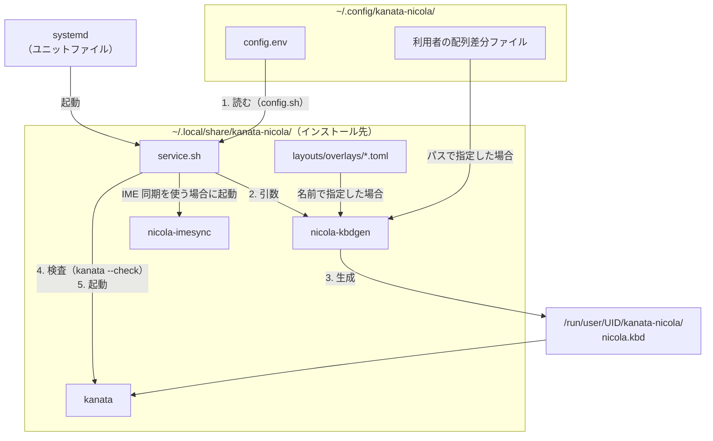

# kanata-nicola 実装仕様書

この文書は、kanata-nicola のソースの構成、各コンポーネントの仕様（コマンド、ファイルの配置と形式）、テストの方法を説明する。方式とその理由は[設計書](design.md)、生成する kanata の設定ファイル（`.kbd`）の仕組みは[kanata の設定ファイルの設計](kanata-kbd-design.md)にある。

---

## 1. リポジトリの構成

リポジトリのファイルは、次のとおり。

| 分類 | パス | 内容 |
|---|---|---|
| Rust のクレート | `crates/nicola-layout` | 配列定義ファイル・配列差分ファイルの読み込み（[§3](#3-配列定義ファイル)）、キーコード名の表 |
| | `crates/nicola-kbdgen` | kanata 設定生成器（ライブラリとコマンド。[§2](#2-kanata-設定生成器nicola-kbdgen)）。送出の表（ローマ字）。シミュレーション（[§6.2](#62-シミュレーション)） |
| | `crates/nicola-imesync` | IME 同期の常駐ツール（Linux の fcitx5 用。[§4](#4-ime-同期nicola-imesync)） |
| | `crates/nicola-e2e` | 実機経路の E2E（[§6.3](#63-e2e)） |
| | `crates/nicola-testcases` | ケース表の記法と読み込み |
| 配列の定義 | `layouts/nicola-j.toml` | NICOLA J型の配列定義（標準配列。[§3](#3-配列定義ファイル)） |
| | `layouts/overlays/` | 同梱の配列差分ファイル（`practical.toml`、`lag-tolerant.toml`。[配列差分ファイル §3](layout-overlays.md#3-同梱の配列差分ファイル)） |
| 生成済みの設定ファイル | `kbd/` | kanata 単体で使う（常駐サービスを使わずに、kanata に設定ファイルを指定して起動する）ための設定ファイル（`nicola.kbd`、`nicola-lag-tolerant.kbd`、`user-custom.kbd`。[§2.3](#23-生成済みの設定ファイルkbd)） |
| テストのデータ | `testdata/kanata_prefix_cases.toml` | ケース表（入力と、期待する出力。[§6.2](#62-シミュレーション)） |
| Linux 用 | `platform/linux/install.sh`、`uninstall.sh` | 常駐サービスのインストール・更新・アンインストール（[§5.2](#52-インストールと更新installsh)・[§5.5](#55-そのほかのスクリプト)） |
| | `platform/linux/install-files.sh` | インストール先へコピーするファイルと、ユニットファイル（systemd のユーザサービスの定義）の内容（`install.sh` が使用する） |
| | `platform/linux/service.sh` | ユーザサービスが実行するスクリプト。起動のたびに、設定から kanata の設定ファイルを生成・検査して、kanata を起動する（[§5.3](#53-常駐サービスの起動servicesh)） |
| | `platform/linux/config.sh` | 利用者の設定から、kanata 設定生成器と kanata の引数を組み立てる（[§5.4](#54-設定から引数への変換configsh)） |
| | `platform/linux/permissions.sh` | kanata に必要な権限の確認と設定（[§5.5](#55-そのほかのスクリプト)） |
| | `platform/linux/run.sh` | 常駐サービスを使わない手動起動（[§5.5](#55-そのほかのスクリプト)） |
| | `platform/linux/config.env.example` | 利用者の設定ファイル（`config.env`）のひな形 |
| | `platform/linux/kanata/` | kanata に修正を適用してビルドするスクリプト（`build.sh`）、修正（`patches/`）、その説明（[README.md](../platform/linux/kanata/README.md)） |
| 文書 | `docs/` | 利用者向けと開発者向けの文書 |

- OS に依存するもの（導入と常駐のスクリプト、kanata をビルドするスクリプト）は `platform/<OS>/` に置く。
  - 現在は Linux のものだけがある。Windows は正式サポート前（試用は可能）で、生成済みの `kbd/` を kanata の Windows 版で使用する（[Windows での利用](windows.md)）。
- ワークスペースの `target/` には、ビルドの結果のほか、修正を適用した kanata（`target/kanata-patched/`）と、手動起動の設定ファイルとログ（`target/run/`）が置かれる。

## 2. kanata 設定生成器（nicola-kbdgen）

kanata 設定生成器は、配列定義と配列差分ファイルから、kanata の設定ファイル（`.kbd`）を生成する（`crates/nicola-kbdgen`。ライブラリとコマンド）。

### 2.1 実行方法とオプション

コマンドは PATH にはインストールしないので、リポジトリの直下で、次のように `cargo run` で実行するか、ビルドした `target/release/nicola-kbdgen` を使用する。手動起動（`run.sh`）も `cargo run` で実行し、常駐サービスは `install.sh` がインストール先にコピーしたもの（[§5.1](#51-ファイルの配置)）を使用する。

```text
cargo run --release -p nicola-kbdgen -- [options] [-o <file>]
```

オプションは、次のとおり。

| オプション | 内容 | 既定 |
|---|---|---|
| `--layout <file>` | 配列定義ファイル（[§3](#3-配列定義ファイル)） | 同梱の NICOLA J型 |
| `--overlay <file>` | 重ねる配列差分ファイル（複数可。指定した順に重ねる） | なし |
| `--thumbs <L>:<R>` | 左右の親指キーのキーコード名（修飾キーは不可） | `KEY_MUHENKAN:KEY_HENKAN` |
| `--toggle <KEY\|none>` | NICOLA 切替キー（キー本来の出力も送出する）。`none` は NICOLA 切替キーを置かない（IME 同期で使用する） | `KEY_GRAVE`（半角/全角） |
| `--key-as-ctrl <KEY>` | 左右の Ctrl のほかに、Ctrl として扱うキー（複数可） | なし |
| `--include-device <name>` | 対象にするキーボードの名前（複数可。調べ方は[設定リファレンス §3.1](settings.md#31-設定値の調べ方)） | すべてのキーボード |
| `--exclude-device <name>` | 除外するキーボードの名前（複数可） | なし |
| `--extra-kbd <file>` | 利用者の kanata の設定ファイル（キーの再割り当て等。[設定リファレンス §3.2](settings.md#32-追加の-kanata-の設定ファイル)）。生成する設定ファイルの末尾で、絶対パスにして `include` で読み込む（kanata は、存在しないファイルをエラーにせずに無視し、相対パスを生成した設定ファイルの場所から読み込むため。ファイルが存在することは kanata 設定生成器が確認する） | なし |
| `-o <file>` | 出力先 | 標準出力 |
| `--split` | 環境固有設定（`defcfg`、Ctrl として扱うキー）を、`-o` の出力先と同じディレクトリの `user-custom.kbd` に分ける（`-o` が必要）。`-o` に出力する配列プロファイル（[設計書 §1.2](design.md#12-用語)）は、それを `include` で読み込む。既存の `user-custom.kbd` が生成する内容と異なる場合は、編集したものとみなして上書きしない | 分けない（1 つのファイルに出力する） |
| `--force` | `--split` で、既存の環境固有設定も上書きする | — |
| `-h`、`--help` | 使い方を表示する | — |

### 2.2 誤りの検査

kanata 設定生成器は、生成するときに、次の誤りをエラーにする（kanata が設定ファイルを検査する前に見つける。kanata のエラーのメッセージでは、原因が分かりにくいため）。各検査の理由は、`crates/nicola-kbdgen/src/lib.rs` のコメントにある。

- 役目を持つキーの誤り: 親指キー・NICOLA 切替キー・修飾キー・Ctrl として扱うキーの面、1 つのキーへの 2 つ以上の役目、修飾キーの親指キー
- 送出できない面（[設計書 §6.2](design.md#62-配列差分ファイルによる調整)）
- 生成する設定ファイルの文字列・コメントを壊す値（二重引用符・制御文字を含むキーボードの名前・パス、制御文字を含む配列定義の名前と出典・配列差分ファイルの名前）と、存在しない `--extra-kbd` のファイル

生成した設定ファイルは、`kanata --check -c <file>` で、kanata の記述として誤りが無いかを検査できる。

### 2.3 生成済みの設定ファイル（kbd/）

`kbd/` には、kanata 単体で使う利用者のために、生成済みの設定ファイルを置いている（Rust の環境が必要な kanata 設定生成器の実行は不要である）。

kanata 設定生成器・標準配列・同梱の配列差分ファイルを変更した場合は、次のコマンドで `kbd/` を再生成する。再生成が行われていない場合は、`kbd/` が kanata 設定生成器の出力と一致することを確かめるテスト（`crates/nicola-kbdgen/tests/generate.rs`）により、更新漏れを検知する。

```sh
cargo run --release -p nicola-kbdgen -- --split --force -o kbd/nicola.kbd
cargo run --release -p nicola-kbdgen -- --overlay layouts/overlays/practical.toml --overlay layouts/overlays/lag-tolerant.toml --split --force -o kbd/nicola-lag-tolerant.kbd
```

## 3. 配列定義ファイル

配列定義ファイルは、各キーの 3 つの面の文字（かな・記号）を記述する TOML のファイルである。記述するのは入力される文字（`か` など）で、IME に送出するキー列（`k` `a`）は記述しない。文字を送出のキー列に変換するのは kanata 設定生成器で、その対応は送出の表（[設計書 §7.1](design.md#71-ローマ字方式)）で決まる。ただし、面を ASCII の文字で記述した場合は、ローマ字とみなし、記述したとおりのキーを送出する（[設計書 §6.2](design.md#62-配列差分ファイルによる調整)）。

標準配列（`layouts/nicola-j.toml`）は、ビルドのときに kanata 設定生成器に組み込まれる。設定（`config.env`）に配列定義ファイルを指定する項目は無く、利用者は配列差分ファイルで配列を変更する。別の配列定義ファイルは、kanata 設定生成器の `--layout` で指定する（[§2.1](#21-実行方法とオプション)）。

標準配列を変更した場合に、変更が反映される時点は、次のとおり。

| 使う所 | 反映される時点 |
|---|---|
| 常駐サービス | `install.sh` を実行したとき（インストール先の kanata 設定生成器が置き換わる）。常駐サービスの再起動だけでは反映されない |
| 手動起動（`run.sh`） | 次に起動したとき（起動のたびに、kanata 設定生成器をビルドする） |
| `kbd/` | 再生成のコマンド（[§2.3](#23-生成済みの設定ファイルkbd)）を実行したとき |

例（標準配列の冒頭と、D01 のキー）:

```toml
[meta]
name = "NICOLA J型"
source = "NICOLA配列規格書 2000-01-08 + 2018-11正誤、数字段は JIS 提案の J型図＋〜『』の追加"

[keys.KEY_Q]           # D01
pos = "D01"
solo = "。"
lthumb = "ぁ"
rthumb = "゜"
```

| 項目 | 内容 |
|---|---|
| `[meta]` `name`・`source` | 名前と出典。生成する設定ファイルの冒頭に記述される |
| `[keys.<キーコード名>]` | 1 つのキー（JIS 106/109 キーボードのキー） |
| `pos` | JIS の位置記号（E01〜E13、D01〜D12、C01〜C13、B01〜B11）。キーは、この順に並べて扱う |
| `solo`・`lthumb`・`rthumb` | 単独面・左親指の面・右親指の面。規格で定義されていない面は記述しない |

配列差分ファイル（[配列差分ファイル §2](layout-overlays.md#2-書式)）は、配列定義ファイルと同じ項目のうち、変更する面だけを記述する（`[meta]` と `pos` は任意）。読み込みは、配列定義ファイルと同じ `crates/nicola-layout` で行う。誤りとして扱うもの（[配列差分ファイル §1](layout-overlays.md#1-仕組みと利用方法) の「誤りがある場合」）も、配列定義ファイルと同じである。

## 4. IME 同期（nicola-imesync）

nicola-imesync は、fcitx5 の状態に合わせて、kanata のレイヤを切り替える（`crates/nicola-imesync`。方式は[設計書 §8.2](design.md#82-ime-同期の動作)）。コマンドとオプションは、次のとおり。

```text
nicola-imesync [--port <n>] [--fallback-ms <n>] [--im <name>] [--on-layer <name>] [--off-layer <name>] [--dry-run]
```

| オプション | 内容 | 既定 |
|---|---|---|
| `--port` | kanata の TCP ポート | 23800 |
| `--fallback-ms` | 通知が無いときに、状態を読み取る間隔（0 で無効） | 1000 |
| `--im` | NICOLA 入力を使う入力メソッドの名前 | `mozc` |
| `--on-layer` / `--off-layer` | NICOLA が ON / OFF のときの kanata のレイヤ | `nicola` / `base` |
| `--dry-run` | kanata へ送信せず、状態の変化を表示するだけにする | — |
| `-h`、`--help` | 使い方を表示する | — |

nicola-imesync は、次の処理を繰り返す。

1. D-Bus のセッションバスで、fcitx5 の状態を読み取る（読み取るものと経路は、後の表）。
2. 設計書の ON の条件（入力メソッドは `--im`）と、状態を読み取れない場合の扱いに従って、`--on-layer` か `--off-layer` を選ぶ。
3. 選んだレイヤを、現在の接続でまだ送信していない場合は、kanata の TCP ポートへ `{"ChangeLayer":{"new":"<layer>"}}` を送信する。kanata が接続を閉じた（終了・再起動した）場合は、接続し直して、現在のレイヤを送信する（[設計書 §9](design.md#9-常駐)）。送信できない場合は、次に状態を読み取るとき（既定では 1 秒以内）に送信し直す。
4. fcitx5 の通知、`--fallback-ms` の経過（通知の取りこぼしに備える）、kanata が接続を閉じたことのいずれかまで待ち、1 に戻る。

読み取る状態と、その経路は次のとおり。

| 読み取る状態 | 経路 |
|---|---|
| 入力欄のフォーカス | fcitx5 の `org.fcitx.Fcitx.Controller1` の `State`（0 = フォーカスのある入力欄が無い。1 = 入力メソッドが一覧の先頭のもの、2 = それ以外） |
| 入力メソッド | 同じインタフェースの `CurrentInputMethod`（`mozc`、`keyboard-jp` 等）。フォーカスのあるウィンドウの入力メソッドを返す |
| Mozc の入力モード（トレイ） | fcitx5 のトレイ項目のメニュー（`com.canonical.dbusmenu`）のアイコン名（`fcitx-mozc-hiragana` 等） |
| Mozc の入力モード（入力パネル） | fcitx5 が入力パネル（入力中の文字や変換の候補を表示する、デスクトップの UI）に送信するシグナルの文字列に含まれる、入力モードのアイコン名（現在の入力メソッドのアイコン）。トレイ項目から読み取れない場合に使用する。入力モードのアイコン名を 2 つ以上含むシグナル（入力モードのメニュー）は使用しない |

fcitx5 の通知は、D-Bus のシグナルで受信する。受信するシグナルと、その扱いは次のとおり。

| 項目 | 内容 |
|---|---|
| fcitx5 のシグナル | fcitx5（`org.fcitx.Fcitx5`）が全体に送信するもの。インタフェースは問わない（送信するシグナルは、fcitx5 が使う UI で異なる） |
| トレイ項目のシグナル | fcitx5 のトレイ項目（`org.kde.StatusNotifierItem`）と、そのメニューのもの |
| 無視するシグナル | nicola-imesync を宛先にしたもの（同じ利用者のどのプログラムからも送信できるため） |
| シグナルの内容 | 入力パネルへのシグナルには、入力中の文字が含まれることがある。取り出すのは、入力モードのアイコン名だけである |

次の細部は、`crates/nicola-imesync/src/main.rs` のコメントにある。

- fcitx5-mozc のバージョンによる、入力モードの示し方の違い
- 続けて届くシグナルをまとめる間隔
- トレイ項目を作成し直したとき（fcitx5 やデスクトップのトレイの再起動、fcitx5 の UI の切り替え）の探し直し方

**ログ:** fcitx5 の状態が変化するたびに、1 行を記録する。kanata との接続については、接続したとき、kanata が接続を閉じたとき、接続していた kanata へ送信できなくなったときに、1 行ずつ記録する。ログの例は、次のとおり。

```text
  12.345s  fcitx5=2 im=mozc mozc=hiragana -> nicola  (by signal NewIcon)
connected to kanata (port 23800); layer nicola
```

状態の行の `fcitx5=` は `State` の値、括弧の中は変化を見つけた契機（`by signal`: fcitx5 の通知、`by poll`: `--fallback-ms` の経過、`by kanata reconnect`: kanata が接続を閉じたこと、`by start`: 起動）である。fcitx5 の状態を読み取れないとき（fcitx5 の起動前等）のエラーは、同じものを続けて記録しない。

## 5. 常駐サービス（Linux）

この章は、Linux の常駐サービスについて、ファイルの配置、kanata-nicola が Linux 用に同梱するスクリプト（`platform/linux/`。導入・常駐・手動起動）の仕様、ログを説明する。kanata をビルドするスクリプト（`kanata/build.sh`）は、[platform/linux/kanata/README.md](../platform/linux/kanata/README.md) で説明している。

### 5.1 ファイルの配置

常駐サービスのファイルの置き場所は、作成するものごとに次のとおり（起動のたびに、どのファイルを読み、何を生成するかは [§5.3](#53-常駐サービスの起動servicesh) の図）。

**利用者が作成するファイル（どれも任意）:**

| 置き場所 | 役割 | 作成しない場合 |
|---|---|---|
| `~/.config/kanata-nicola/config.env` | 利用者の設定（[設定リファレンス](settings.md)）。常駐サービスが起動のたびに読み込み、kanata 設定生成器と kanata の引数にする。`install.sh`（インストールの前の確認）と `run.sh` も読み込む | すべての設定が既定値になる |
| `~/.config/kanata-nicola/*.toml` | 利用者の配列差分ファイル（例: `user-layout.toml`）。`NICOLA_LAYOUT_OVERLAYS` に記述した場合だけ読み込む | 同梱の配列差分ファイルだけを使用できる |
| `~/.config/kanata-nicola/*.kbd` | 利用者の追加の kanata の設定ファイル（例: `user-extra.kbd`）。`NICOLA_EXTRA_KBD` に記述した場合だけ、生成した設定ファイルが `include` で読み込む | 追加の定義を使用しない |

**`install.sh` が作成するファイル（常駐サービスに必要）:**

| 種別 | 置き場所 | 役割 |
|---|---|---|
| プログラム | `~/.local/share/kanata-nicola/nicola-kbdgen` | kanata 設定生成器（release ビルドのコピー）。標準配列を内蔵する（[§3](#3-配列定義ファイル)） |
| | `~/.local/share/kanata-nicola/kanata` | 常駐サービスが起動する kanata の実行ファイル。修正を適用した kanata（`target/kanata-patched/kanata`）のコピー。`NICOLA_KANATA_BIN` を指定した場合は置かず、指定した kanata を起動する |
| | `~/.local/share/kanata-nicola/nicola-imesync` | IME の状態に合わせて kanata の NICOLA 入力を切り替える常駐ツール（release ビルドのコピー） |
| スクリプト | `~/.local/share/kanata-nicola/service.sh`、`config.sh` | ユーザサービスが実行するスクリプトと、設定の読み込みに使用するスクリプト（[§5.3](#53-常駐サービスの起動servicesh)・[§5.4](#54-設定から引数への変換configsh)） |
| 配列差分ファイル | `~/.local/share/kanata-nicola/layouts/overlays/*.toml` | 同梱の配列差分ファイルのコピー。設定に名前だけを記述した配列差分ファイルは、ここから読み込む |
| ユニットファイル | `~/.config/systemd/user/kanata-nicola.service` | kanata のユーザサービス（[§5.3](#53-常駐サービスの起動servicesh)）。ログイン時に kanata を起動し、異常終了した場合に再起動する |
| | `~/.config/systemd/user/kanata-nicola-imesync.service` | nicola-imesync のユーザサービス（[§5.3](#53-常駐サービスの起動servicesh)）。IME 同期を使う設定の場合だけ、nicola-imesync を起動する |

インストール先（`~/.local/share/kanata-nicola/`）は全体を、ユニットファイルは各ファイルを、`install.sh` を実行するたびに置き換える（[§5.2](#52-インストールと更新installsh)。編集した内容は残らない）。どちらも `uninstall.sh` で削除される（[§5.5](#55-そのほかのスクリプト)）。

**常駐サービスが作成するファイル:**

| 置き場所 | 役割 |
|---|---|
| `/run/user/<uid>/kanata-nicola/nicola.kbd` | kanata が読み込む設定ファイル。起動のたびに利用者の設定から生成する。サービスの実行時のディレクトリ（ユニットファイルの `RuntimeDirectory=`）にあり、サービスが停止すると削除される。編集した設定ファイルを使用する場合は、これを編集せずに[kanata の設定ファイルの手引き](kanata-kbd.md)に従う |

### 5.2 インストールと更新（install.sh）

`install.sh` は、常駐サービスをインストール・更新するスクリプトである。初めてインストールするときと、更新を取得した（`git pull`）後に実行する。

設定（`config.env`）を変更したときは、`install.sh` の実行は不要である。常駐サービスは起動のたびに `config.env` を読み込むので、`systemctl --user restart kanata-nicola` で反映される。ただし、`NICOLA_KANATA_BIN` の指定を外したときは、インストール先に kanata を置くために `install.sh` を実行する。

処理は次の順で、失敗した場合はその時点で停止する（インストール先を置き換える手順 3 より前に停止した場合は、前にインストールした常駐サービスがそのまま残る）。

1. 権限（`permissions.sh --check`。[§5.5](#55-そのほかのスクリプト)）、設定（`config.sh`。[§5.4](#54-設定から引数への変換configsh)）、ビルドに必要なもの（[導入と利用 §2](usage.md#2-導入)）を確認する。
2. kanata 設定生成器と nicola-imesync をビルドする。修正を適用した kanata は、初回と、基にするバージョンか修正が変更されたときにビルドする（`NICOLA_KANATA_BIN` を指定した場合はビルドしない）。
3. 新しいインストール先にファイルをコピーし（[§5.1](#51-ファイルの配置)）、その `service.sh check` で設定を検査してから、インストール先を置き換える。
4. ユニットファイルを書き込んで登録し直し（`systemctl --user reenable`）、動作中のサービスを再起動する（`--start` を指定した場合は、停止中のサービスも起動する）。
5. 結果を表示する。起動・再起動したサービスが動作していない場合は、原因の調べ方を表示して、終了コード 1 で終了する。

### 5.3 常駐サービスの起動（service.sh）

常駐サービスは 2 つの systemd のユーザサービスで、どちらもユニットファイルから `service.sh` を実行する。ユニットファイルは、`install.sh` が `~/.config/systemd/user/` に書き込む（内容は `install-files.sh` が生成する）。各行の理由は、ユニットファイルのコメントにある（インストールしたユニットファイルは `systemctl --user cat kanata-nicola kanata-nicola-imesync` で表示できる）。起動・停止の方針は[設計書 §9](design.md#9-常駐)にある。

| ユーザサービス | 実行するコマンド |
|---|---|
| `kanata-nicola.service` | `service.sh kanata` |
| `kanata-nicola-imesync.service` | `service.sh imesync`（`service.sh ime-sync-on` が成功した場合だけ。`ExecCondition=`） |

**常駐サービスの起動の流れ:** `kanata-nicola.service` は、起動のたびに、利用者の設定とインストール先のファイルから kanata の設定ファイルを生成して、kanata を起動する。ファイルと処理の流れは、次のとおり（枠はディレクトリ、矢印の番号は処理の順）。



手動起動（`run.sh`）も同じ流れで、リポジトリの中のもの（`target/`、`layouts/overlays/`）を使用し、設定ファイルを `target/run/nicola.kbd` に生成する（[§5.5](#55-そのほかのスクリプト)）。

`service.sh` は、設定を `config.env` だけから読み込む（同じ名前の環境変数は使用しない）。設定に誤りがある場合と、ほかの kanata が動作している場合は、終了コード 78（`EX_CONFIG`）で終了し、ユーザサービスは再起動しない。ほかのコマンド（`install.sh` が使用する設定の検査、`ExecCondition=` の判定、nicola-imesync の起動）は、`service.sh` の冒頭のコメントにある。

### 5.4 設定から引数への変換（config.sh）

`config.sh` は、利用者の設定（`config.env`）を、kanata 設定生成器と kanata の引数に変換する（`service.sh`・`install.sh`・`run.sh` が読み込む）。名前どおりでない変換は、次のとおり。

| 設定 | kanata 設定生成器の引数 | kanata の引数 |
|---|---|---|
| （設定によらない） | `--exclude-device nicola-e2e-input --exclude-device nicola-e2e-output`（E2E の仮想キーボードと、E2E で起動する kanata の出力デバイス。kanata が自動で除外する出力デバイスは、名前が `kanata` のものだけであるため） | |
| `NICOLA_IME_SYNC=1` | `--toggle none` | `-p 127.0.0.1:<NICOLA_KANATA_PORT>` |
| `NICOLA_KANATA_BIN` | | 起動する kanata の実行ファイル |
| `NICOLA_WAIT_DEVICE_MS` | | `--wait-device-ms <ms>`。省略した場合は、`NICOLA_KANATA_BIN` の指定が無いときは `--wait-device-ms 0`、指定があるときは付けない（kanata の既定の 200ms） |

表に無い設定は、対応する kanata 設定生成器のオプション（[§2.1](#21-実行方法とオプション)）に変換する（左右の組の `NICOLA_THUMB_KEYS` を除き、値が複数ある設定は 1 つずつ。相対パスは設定の置き場所を起点にし、配列差分ファイルの名前は同梱のファイルのパスにする）。

### 5.5 そのほかのスクリプト

- **permissions.sh（権限の確認と設定）:** 初めてインストールする前に、利用者が 1 回実行する（`install.sh` は権限を確かめるだけで、設定はしない）。kanata に必要な権限（キーボードのデバイスの読み取り、`/dev/uinput` の読み書き）を調べ、不足しているものを設定するコマンドを表示して、確認を求めてから実行する（`--check` は調べるだけで、`install.sh` が使用する）。設定の方法は [kanata の Linux 向けの案内](https://github.com/jtroo/kanata/blob/main/docs/setup-linux.md)と同じである。違いは、既存のもの（グループ、udev の規則のファイル）を作成し直さないことと、ほかのデバイスに影響しないように、`udevadm trigger` を uinput だけに行うことである。
- **uninstall.sh（アンインストール）:** 常駐サービスをアンインストールする。2 つのサービスを停止して無効にし、ユニットファイルとインストール先（`~/.local/share/kanata-nicola/`）を削除する（削除の前に確認を求める。`-y` を指定すると確認を省略する）。利用者の設定（`~/.config/kanata-nicola/`）と権限の設定は残す。
- **run.sh（手動起動）:** 常駐サービスを使わずに、kanata をターミナルで起動する（開発中の確認用）。停止するには、そのターミナルで Ctrl+C を入力する。
  - 起動の前に、ほかの kanata（実行ファイルの名前が `kanata` で始まるもの）が動作していないことを確認し、設定ファイルを `target/run/nicola.kbd` に生成して検査する。
  - 設定は `config.env` から読み込む。`config.env` に記述していない設定は、同じ名前の環境変数をコマンドの前に付けて、一時的に指定できる。
  - kanata は、`NICOLA_KANATA_BIN`、修正を適用した kanata、PATH の kanata の順に探す（ビルドはしない）。修正を適用した kanata が、現在の修正（`patches/`）からビルドしたものでない場合は警告する。
  - IME 同期を使う設定の場合は、nicola-imesync もビルドして起動し、終了時に停止する。

### 5.6 ログ

常駐サービスと手動起動のログは、次のとおり。

| 項目 | 内容 |
|---|---|
| 記録先 | 常駐サービスは systemd のユーザジャーナル（`journalctl --user`。見方は[導入と利用 §4](usage.md#4-トラブルへの対処)）。手動起動（`run.sh`）は `target/run/` のファイル（`kanata-<日時>.log`、`imesync-<日時>.log`） |
| 記録内容（kanata） | 起動・終了、キーボードの取得と切断（`registering`・`removing` など）、警告とエラー。レイヤの切り替えは記録しない（生成する設定ファイルの `defcfg` の `log-layer-changes no`。理由は[設計書 §9](design.md#9-常駐)）。手動起動では、確認のために記録する（`--log-layer-changes`） |
| 記録内容（nicola-imesync） | IME の状態の変化と、kanata との接続（[§4](#4-ime-同期nicola-imesync)） |
| 入力した文字 | kanata・nicola-imesync のどちらも記録しない |
| 保存期間 | kanata-nicola では決めず、システムの journald の設定（`/etc/systemd/journald.conf`）に従う。手動起動のログは、削除するまで残る |

## 6. テスト

ビルドとテストに必要なものは、[導入と利用 §1](usage.md#1-動作環境)にある。テストの段階と、実行するコマンドは次のとおり。

| 段階 | 内容 | 実行 |
|---|---|---|
| 単体 | 配列定義・配列差分ファイルの読み込み、送出の表（配列のすべての文字と、ローマ字で記述した面を送出できること）、kanata 設定生成器の入力の検査、nicola-imesync（ON の条件と、再起動した kanata へのレイヤの送信）。文書と実物の一致（生成済みの設定ファイル `kbd/` が最新であること、文書の表と例、節への参照） | `cargo test --release` |
| シミュレーション | kanata をライブラリとして組み込み、生成した設定ファイルで入力列を処理して、出力をケース表の期待値と比較する。ランダムな高速打鍵と、修飾キー・NICOLA 切替キー・配列差分ファイル等の動作も確認する | `cargo test --release` |
| 設定の組み合わせ | `config.env` の値の組み合わせごとに、`config.sh` が変換する引数から、生成した設定ファイルの動作までを確認する。導入と常駐のスクリプト（`install-files.sh`・`service.sh`・`permissions.sh`）の動作、設定の一覧と既定値が文書と一致することも確認する。bash が必要なため、Linux だけで実行する | `cargo test --release` |
| E2E | 仮想キーボード → 実際の kanata のプロセス → kanata の出力デバイスの経路で、ケース表を実行する。キーボードの抜き差し、TCP ポートで受け付ける命令、資源使用（CPU・メモリ）も確認する | `cargo run --release -p nicola-e2e` |

設定の組み合わせの選び方は、`crates/nicola-kbdgen/tests/config_combinations.rs` の冒頭にある。コードの書式は rustfmt に従う（`rustfmt.toml`。`cargo fmt --check` で確認する）。

`cargo test --release` の時間の大半は、シミュレーション（kanata が設定ファイルを読み込む時間）である。debug ビルドではさらに時間がかかるため、`--release` を指定して実行する。

文書だけを直したときは、文書を読むテスト（リンクと節の参照、文書の表・例・一覧が実物と合うか）だけを、`cargo test --release docs_` で実行できる。文書を読むテストは、名前を `docs_` で始める。

### 6.1 シミュレーションと E2E の分担

シミュレーションと E2E は、同じケース表を実行するが、役割が異なる。生成した設定ファイルによる判定と送出は、シミュレーションで確かめる。kanata のプロセスと OS の間の動作（キーボードの取得、TCP ポート、資源使用）は、E2E で確かめる。

それぞれが確かめる項目は、次のとおり。シミュレーションには、段階「設定の組み合わせ」で行うシミュレーションも含む。表の記号は、○ が確かめるもの、△ が一部だけを確かめるもの、× が確かめないもの。

**シミュレーションと E2E で確かめる項目**

| 項目 | シミュレーション | E2E | 備考 |
|---|---|---|---|
| ケース表 | ○ | ○ | 比較の方法が異なる（下の表） |
| ランダムな高速打鍵 | ○ | × | ローマ字の送出の結果が判定と食い違わないこと（[§6.2](#62-シミュレーション)）と、修飾キーを交えた打鍵で押したままのキーが残らないことを確かめる |
| 設定と配列ごとの動作 | ○ | × | 配列差分ファイル、ローマ字で記述した面、Ctrl として扱うキー、NICOLA 切替キー、`config.env` の値の組み合わせ等。E2E は、標準配列と既定の設定だけで実行する |
| IME 同期によるレイヤの切り替え | △ | ○ | シミュレーションは、切り替えた後の動作だけを確かめる。TCP ポートが `ChangeLayer` を受け付け、ほかの命令を拒否すること（パッチ 0004）は、E2E で確かめる |
| キーボードの取得と抜き差し | × | ○ | パッチ 0002 の動作を含む |
| 資源使用（CPU・メモリ） | × | ○ | nicola-imesync は、fcitx5 が動作している場合だけ測定する |
| パッチ 0003 の動作 | × | × | E2E では、再探索とキーの到着が重なる瞬間を作れない。小さなプログラムで確かめた（[platform/linux/kanata/README.md](../platform/linux/kanata/README.md)） |
| fcitx5 の状態の読み取り | × | × | nicola-imesync の単体テストと、手動で確かめる |
| systemctl によるユニットの登録と起動 | × | × | 手動で確かめる |

確かめる方法の違いは、次のとおり。

**シミュレーションと E2E の方法の違い**

| 項目 | シミュレーション | E2E |
|---|---|---|
| kanata | crates.io の kanata（実機と同じバージョン）を、ライブラリとして使う。修正（`platform/linux/kanata/patches/`）は含まない | 実際の kanata のプロセスを起動する。通常は、修正を適用した kanata を使う（探す順は [§6.3](#63-e2e)） |
| 時刻 | 仮想の時刻で 1ms ずつ処理するので、結果は毎回同じになる。`@t` を付けた出力は、時刻も比較する | 実時間で入力する。出力の時刻は OS の処理で数 ms ずれるので比較せず、出力の並びだけを比較する |
| 送出の方式 | Unicode とローマ字の両方（[§6.2](#62-シミュレーション)） | ローマ字だけ（実際に使う設定） |
| 実行の条件 | 特別な権限は不要。`cargo test --release` に含まれる | `/dev/uinput` 等の権限と kanata の実行ファイルが必要なので、`cargo test` には含めない。1 ケースに約 1 秒かかるので、件数の多い確認（ランダムな高速打鍵）はシミュレーションで行う |
| 実行する時期 | 変更のたびに実行する | kanata のバージョンや修正を変更したとき、キーボードの取得・常駐・性能に関わる変更をしたときに実行する |

### 6.2 シミュレーション

**判定と送出の確認:** シミュレーションは、ローマ字で送出する設定ファイルのほかに、送出と切り離して判定だけを確認するため、1 文字を 1 つの Unicode の出力として送出する設定ファイルでも確認する（IME を通らないため、実用には使用しない）。比較の方法は、`crates/nicola-kbdgen/tests/sim_vectors.rs` の冒頭にある。

**ケース表の記法:** 入力は `d:W@0 u:W@60`（キーの押下・離しと、その時刻〔ms〕。`OL`・`OR` は左右の親指キー）、期待する出力は `か@0 [OR]@100`（`@t` を付けると、シミュレーションでは出力の時刻も比較する。差は ±3ms まで許容する）。書式の詳細は、`crates/nicola-testcases/src/lib.rs` とケース表の冒頭にある。

**ランダムな高速打鍵:** ローマ字の送出の結果が、判定（Unicode の送出）の結果と異なるケースが、既定の 1000 件では無いことを確認する（[設計書 §7.2](design.md#72-送出の割り込み対策)）。件数は環境変数 `NICOLA_RANDOM_CASES` で変更でき、その場合は 1.0% 以下を合格にする。

### 6.3 E2E

E2E は、次のコマンドで実行する。

```sh
cargo run --release -p nicola-e2e [-- [--only <case-id>] [--kanata <path>] [--wait-device-ms <ms>]]
```

- `/dev/uinput` と `/dev/input/event*` の読み書きの権限が必要である。
- kanata は、`--kanata` で指定したもの、修正を適用した kanata（リポジトリの `target/kanata-patched/kanata`。実行するディレクトリによらない）、PATH の kanata の順に探す。
- **安全策:** テスト用の kanata には、テスト用の仮想キーボード（`nicola-e2e-input`）だけを取得させる。kanata の出力デバイス（`nicola-e2e-output`）はテストが排他的に取得し、デスクトップへは出力しない。仮想キーボードは、kanata が取得するまでは、デスクトップからは通常のキーボードに見える。そのため、テスト用の kanata がそのデバイスを取得したことを確認してから（[設計書 §10.4](design.md#104-キーボードの取得と再接続の制約linux)）キーを入力し、確認できない場合は中止する。確認の方法は `crates/nicola-e2e/src/main.rs` の冒頭にある。
- 常駐中の kanata がある場合も、その設定ファイルがテスト用の仮想キーボードを除外している場合は、並行して実行できる（`platform/linux/` のスクリプトで生成した設定ファイルは除外している。[§5.4](#54-設定から引数への変換configsh)）。除外を確認できない場合は中止する。

E2E は、ケース表のほかに、次の項目を確認する。

- **キーボードの抜き差し:** kanata がキーボードを取得し直すまでの時間、接続し直した後の入力、キーを押したまま取り外した後に親指キーのシフト（押している間のレイヤ）と出力のキーが残らないことを確認する。kanata の待ち時間（`--wait-device-ms`）は、既定で 0ms にする（パッチ 0002 の無い kanata では、毎回キーボードを取得し直せない条件）。
- **TCP ポート:** `ChangeLayer` でレイヤが切り替わり、通知が返ること、`ReloadFile`・`ActOnFakeKey` にはエラーが返り、接続が切断されること（パッチ 0004。[設計書 §10.5](design.md#105-tcp-ポート)）を確認する。拒否される命令は、存在しないパスと仮想キーを指定するため、パッチの無い kanata で実行しても、kanata の設定と状態は変わらない（その 2 つの確認が失敗する）。
- **資源使用:** kanata の打鍵中と無操作時、nicola-imesync の無操作時（fcitx5 が動作している場合）の CPU とメモリの使用量を測定し、基準（測定した値に数倍の余裕を持たせた値）を超えた場合は失敗にする。
