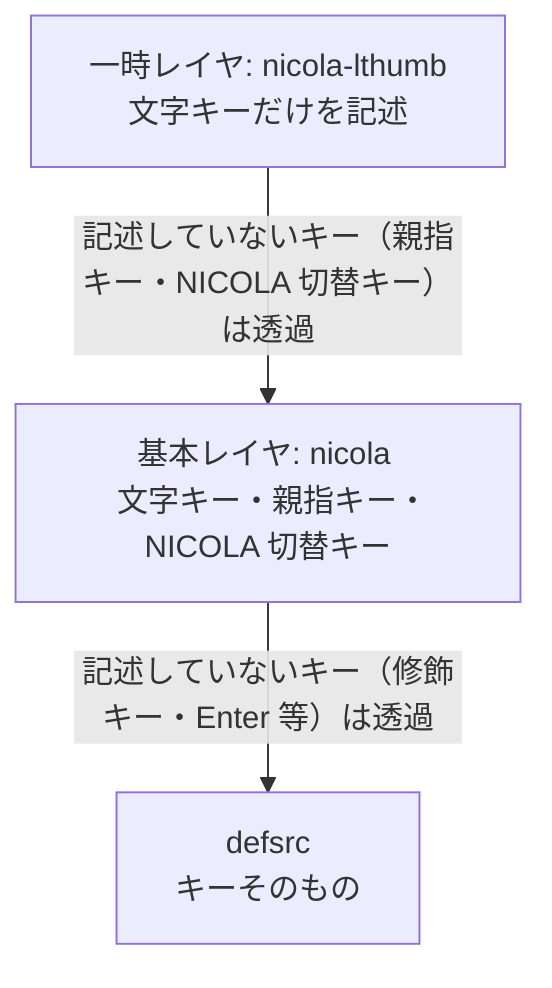
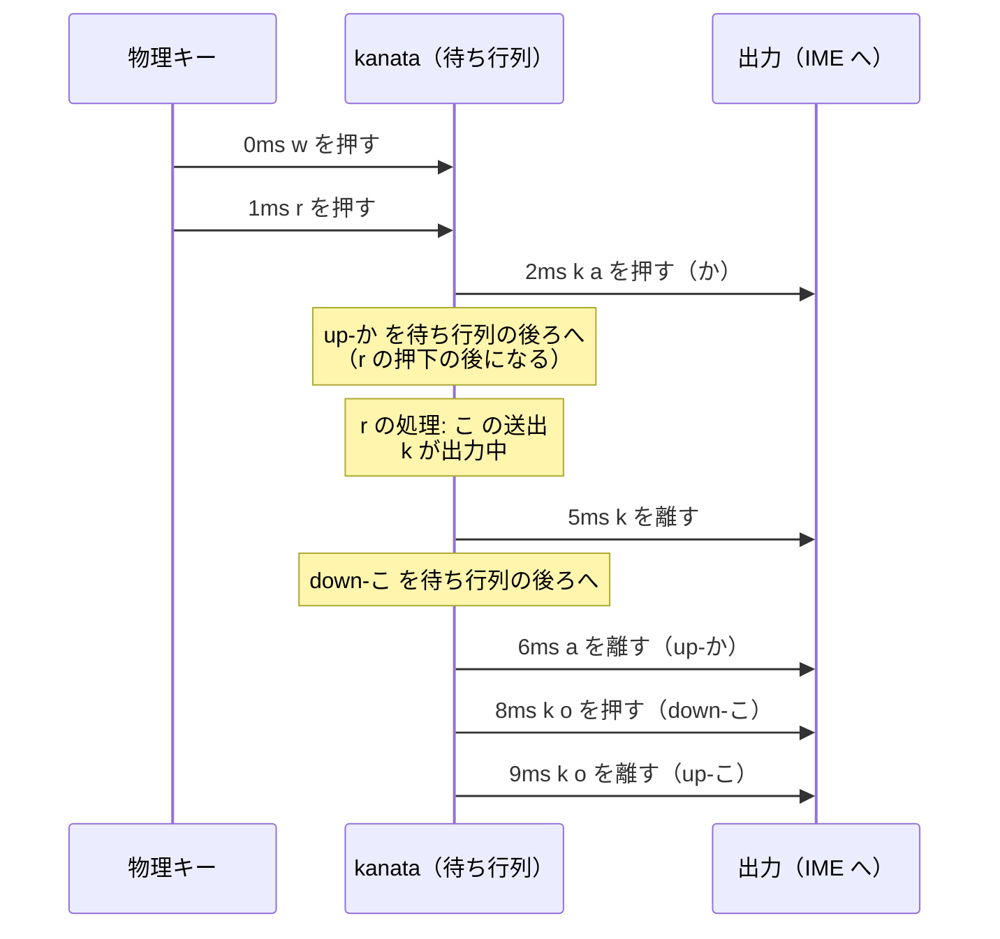

# kanata の設定ファイル（.kbd）の設計

この文書は、kanata 設定生成器（`nicola-kbdgen`）が生成する kanata の設定ファイル（`.kbd`）において、NICOLA の判定・送出・切り替えを実現する定義の組み方と、命名規則を、その理由とともに説明する。

判定・送出・切り替えの方式（親指先行方式等）とその理由は[設計書](design.md)、設定ファイルの編集方法は[kanata の設定ファイルの手引き](kanata-kbd.md)にある。

---

## 1. kanata の処理の基本

生成した設定ファイルの定義の組み方は、kanata の次の仕様を前提にしている。この文書で説明する kanata の仕様は、kanata-nicola が使用するバージョン（[設計書 §10.1](design.md#101-使用するバージョンと修正)）で確認したものである。定義の構文は、kanata の[設定ガイド](https://github.com/jtroo/kanata/blob/main/docs/config.adoc)にある。

| 項目 | 内容 |
|---|---|
| 待ち行列と tick | kanata は 1ms ごと（1 tick）に処理を進める。キーの押下・離しは、物理キーも仮想キー（kanata の `defvirtualkeys` で定義し、ほかの動作から押す・離すキー）も 1 本の待ち行列に入り、1 tick に 1 つずつ順に処理される。動作の中で仮想キーを押す（`press-vkey`）・押して離す（`tap-vkey`）と、その押下・離しは、その時点の待ち行列の後ろに入る |
| `defsrc` に無いキー | `process-unmapped-keys yes` の場合は、ほかのキーと同じ待ち行列を通る。`no` の場合は、Linux 版の kanata は、読み取った時点で待ち行列を通さずに出力する |
| `switch` は次の tick | `switch`（kanata の条件分岐の動作）は、条件で選んだ動作を次の tick に実行する。その間、待ち行列の次の入力は処理しない |
| レイヤの重なり | レイヤ（kanata の `deflayermap`）は、上から、一時レイヤ（`layer-while-held` で、キーを押している間だけ積む。後から積んだものが上になる）、基本レイヤ（`layer-switch` で切り替える。起動時は最初に定義したレイヤ）、`defsrc` の順に重なる。レイヤに記述していないキーは透過（下のレイヤの動作）になり、どのレイヤにも記述していないキーは、キーそのものを出力する |
| 動作は押したときに決まる | キーの動作は、押したときに有効なレイヤで決まり、離すまでにレイヤが切り替わっても変わらない |

左の親指キーを押している間のレイヤの重なりは、次のとおり（矢印は、上のレイヤに記述していないキーが、下のレイヤの動作になることを示す）。



## 2. 定義の組み方

NICOLA 入力の機能と、それを実現する定義は、次のとおり。

| 機能 | 定義 | 説明 |
|---|---|---|
| 配列（単独面と左右の親指の面） | `defsrc`、レイヤ、テンプレート（kanata の `deftemplate`。`t!` で展開される）`unshifted`・`shifted`・`shifted-raw`、文字の alias（kanata の `defalias` で名前を付けた動作） | [kanata の設定ファイルの手引き §2.2](kanata-kbd.md#22-文字の割り当ての変更) |
| 親指先行の判定 | 親指の alias の `layer-while-held` | [§2.1](#21-親指先行の判定) |
| 送出の原子性 | テンプレート `sendn`・`keysn`、仮想キー `up-字`・`down-字`、`process-unmapped-keys yes` | [§2.2](#22-送出の原子性) |
| 親指の単独打鍵 | 仮想キー `lthumb-used`・`lthumb-tap`（右は `rthumb-…`）、テンプレート `shifted`・`shifted-raw`、親指の alias | [§2.3](#23-親指の単独打鍵) |
| 修飾キーとの組み合わせ | 変数（kanata の `defvar`）`modifiers`・`keys-as-ctrl`、テンプレートと親指の alias の `switch` | [§2.4](#24-修飾キーとの組み合わせ) |
| NICOLA 入力の ON/OFF | レイヤ `base`・`nicola`、NICOLA 切替キーの alias、kanata の TCP ポート | [§2.5](#25-nicola-入力の-onoff) |

**定義の順:** 生成した設定ファイルで、定義の順の制約（[設計書 §10.3](design.md#103-設定の読み込みの制約)）が当てはまるのは、「`up-字` を `down-字` より先に（`keysn` の中で）、`lthumb-used` を `lthumb-tap` より先に定義する」ということだけである。そのほかの定義は順を問わないので、参照する側と参照される側（レイヤのキーの定義と文字の alias 等）が離れても、機能ごとに設定ファイルの節にまとめている。

### 2.1 親指先行の判定

親指先行の判定は、親指キーを押している間だけ、その親指の面のレイヤを有効にすることで実現する。

| 項目 | 内容 |
|---|---|
| 親指の面のレイヤ | 親指の alias `lthumb`・`rthumb` は、親指キーを押している間、その親指の面のレイヤ `nicola-lthumb`・`nicola-rthumb` を、`layer-while-held` で一時レイヤとして積む。修飾キーを押している場合は積まない（[§2.4](#24-修飾キーとの組み合わせ)） |
| 判定 | 文字キーの動作は、押したときに有効なレイヤで決まる（[§1](#1-kanata-の処理の基本)）。そのため、文字キーを押したときに親指キーが押されているかだけで、親指の面の文字になるかが決まる |
| 連続シフト | 親指キーを押している間は、続けて押した文字キーもすべて親指の面の文字になる（[設計書 §5.2](design.md#52-連続シフト)） |
| 入力の時点 | 判定時間を待たない。文字は、文字キーを押した 2 tick 後に入力される（[§2.2](#22-送出の原子性)） |

[設計書 §5.1](design.md#51-親指先行方式) の操作と結果の表に無い次の場合も、kanata の仕様で結果が決まる（どちらも、テストのケース表 `testdata/kanata_prefix_cases.toml` で確認している）。

| 場合 | 結果 | 理由 |
|---|---|---|
| 文字キーを離す前に、親指キーを離す | 親指の面の文字が入力される | 文字キーの動作は、押したときに決まる（[§1](#1-kanata-の処理の基本)） |
| 両方の親指キーを押してから、文字キーを押す | 後から押した親指キーの面の文字が入力される。どちらの親指キーも、離したときに単独打鍵を送出しない（[§2.3](#23-親指の単独打鍵)） | 後から積んだレイヤが上になる（[§1](#1-kanata-の処理の基本)） |

### 2.2 送出の原子性

1 文字を複数のキー（`か` = `k a`）で送出するとき、その途中にほかのキー（Enter、Ctrl、次の文字）を割り込ませない（方針と、残る可能性は[設計書 §7.2](design.md#72-送出の割り込み対策)）。そのため、1 文字に、alias を 1 つと、送出用の仮想キーを 2 つ定義する。alias はテンプレート `sendn`、仮想キーはテンプレート `keysn` で定義する（n は、送出のキー列のキーの数）。

**テンプレート:** 2 つのキーで送出する文字のテンプレートは、次のとおり。

```lisp
(deftemplate keys2 (char k1 k2)
  (concat up- $char) (multi (release-key $k1) (release-key $k2))
  (concat down- $char) (multi $k1 $k2 (on-press tap-vkey (concat up- $char))))
(deftemplate send2 (char k1 k2)
  $char (switch ($k1 $k2 lsft)
    (multi (release-key $k1) (release-key $k2) (on-press tap-vkey (concat down- $char))) break
    () (multi $k1 $k2 (on-press tap-vkey (concat up- $char))) break))
```

`$char` は文字（`か`）で、alias `か` と、仮想キー `up-か`・`down-か`（`concat` で前に `up-`・`down-` を付ける）の名前になる。テンプレートを送出のキーの数（n）ごとに分けるのは、kanata のテンプレートの引数の数が決まっていて、可変個の引数も、引数ごとに定義を繰り返す仕組みも無いためである。数が合わない場合は、kanata が読み込みのときにエラーにする（[kanata の設定ファイルの手引き §2.4](kanata-kbd.md#24-編集した設定ファイルの検査)）。

1 文字を `keysn` と `sendn` の 2 つの `t!` で定義する（文字を 2 回記述する）のは、仮想キーは `defvirtualkeys` の中、alias は `defalias` の中でしか定義できず、`t!` は、記述したリストの中に展開されるためである。1 つの `t!` で両方を定義するには `t!` をトップレベルに記述する必要があり、読み込みに時間がかかる（[設計書 §10.3](design.md#103-設定の読み込みの制約)）。文字の定義を、キーごとに小さな `defvirtualkeys`・`defalias` に分けるのも、同じ理由である。

**送出の動作:** `switch` の条件 `($k1 $k2 lsft)` のように、キーの名前だけを並べた条件は、そのキーのどれかを kanata が出力しているときに成り立つ。alias の動作は、送出のキーが出力中かで、次のように分かれる。

| 場合 | 動作 |
|---|---|
| 送出のキーがどれも出力中でない（通常） | すべてのキー（`k a`）を同じ tick で押し、仮想キー `up-か` を押して離す。`up-か` の押下が処理される tick で、すべてのキーを離す |
| 送出のキーのどれかが出力中（ロール打鍵で直前の文字と同じキーを使う場合と、直前の文字の Shift が出力中の場合） | すべてのキーをその tick で離し、仮想キー `down-か` を押して離す。`down-か` の押下が処理される tick で、すべてのキーを押し、`up-か` を押して離す |

**割り込みを防ぐ仕組み:** 送出の途中に、ほかのキーが割り込まない理由は、次のとおり。

1. **1 文字のキーを同じ tick で押す。** kanata の出力は tick ごとの押下状態の差分（[設計書 §10.2](design.md#102-判定と送出の制約)）なので、`k` と `a` の押下の間に、ほかのキーの押下は入らない。送出用の仮想キーを、キーごとではなく文字ごとに定義するのも、このためである。仮想キーの押下は 1 tick に 1 つずつ処理される（[§1](#1-kanata-の処理の基本)）ので、キーごとの仮想キーでは、押す時刻・離す時刻がキーごとに異なる。
2. **`switch` の間は、ほかの入力を処理しない。** 文字キーの押下から送出までの 2 tick（`unshifted` と `sendn` の `switch` を 1 つずつ通る）の間、待ち行列の次の入力（Enter 等）は処理されない（[§1](#1-kanata-の処理の基本)）。
3. **すべてのキーが同じ待ち行列を通る。** `process-unmapped-keys yes` により、`defsrc` に無いキー（Enter・BackSpace 等）も待ち行列を通る（[§1](#1-kanata-の処理の基本)）。`no` の場合は、これらのキーが、直前に押した文字の送出より先に出力される。

**ロール打鍵の例:** 「かこ」を入力するときに、`w`（`か`）を 0ms、`r`（`こ`）を 1ms に押した場合の、待ち行列と出力は次のとおり。どちらの文字も `k` を使うので、`こ` は `down-こ` を経由して押す。時刻は、kanata のシミュレーションの結果である。



IME には `k a k o` の順に押下が届き、「かこ」と入力される。

**Shift を押す文字:** 数字段の `？｛｝（）`、ローマ字で記述した面の `z*` 等は、送出のキー列に Shift（`lsft`）を含む文字で、ほかの文字と同じテンプレートで送出する。この文字に固有の扱いは、次の 2 つである。

1. **Shift の出力中に送出する文字は、`down-字` を経由して押す。**
   - Shift も、ほかのキーと同じく `up-字` で離すまで出力中で、その間に次の文字のキーを押すと、Shift と組み合わせて出力される。
   - そのため、Shift を押す文字がある配列（標準配列を含む）では、`sendn` の `switch` の条件に `lsft` を加える（上の動作の表の 2 行目）。
   - Shift を離す `up-字` が先に待ち行列にあるので、次の文字のキーは Shift と組み合わせて出力されない。
2. **Shift と組み合わせるキーは、`lsft` の後に記述する。**
   - 1 つの tick の中の押下は、記述した順に出力される。
   - 例: `？` は `lsft /`。`z*` は `z lsft '` で、`z` は Shift なしで出力される。

### 2.3 親指の単独打鍵

親指キーだけを押して離したときは、キー本来の機能（無変換・変換等）を使用できるように、親指キーそのもの（既定では `mhnk`・`henk`）を送出する。

親指キーを押している間に文字キーを押したかを示すフラグには、仮想キー `lthumb-used`・`rthumb-used`（動作は何もしない `XX`）を使用する。仮想キーが押されている間を、フラグが立っている状態とし、`switch` の条件 `(input virtual lthumb-used)` で参照する。左の親指キーのフラグの操作と、単独打鍵の判定は、次のとおり。

| 時点 | 定義 | 動作 |
|---|---|---|
| 親指キーを押す | 親指の alias の `(on-press release-vkey lthumb-used)` | 左のフラグを下ろす |
| 親指の面で文字キーを押す | テンプレート `shifted`・`shifted-raw` の `(on-press press-vkey lthumb-used) (on-press press-vkey rthumb-used)` | 両方のフラグを立てる（1 つのテンプレートを左右の親指の面で使用するため。押していない親指キーのフラグは、その親指キーを次に押したときに下ろすので、影響しない。両方の親指キーを押している場合は [§2.1](#21-親指先行の判定)） |
| 親指キーを離す | 親指の alias の `(on-release tap-vkey lthumb-tap)` | `lthumb-tap` がフラグを参照し、フラグが下りていて、修飾キーを押していない場合は、左の親指キーそのもの（既定では `mhnk`）を送出する |

親指キーを離したときに、親指キーを送出するかは、次のとおり。

| 分類 | 場合 | 親指キーの送出 | 理由 |
|---|---|---|---|
| 修飾キーなし | 文字キーを押した | 送出しない | 親指の面のレイヤに記述した文字キーは、すべてフラグを立てる（テンプレート `shifted`・`shifted-raw`）。単独面と同じ文字の面や、規格で未定義の面（単独面の文字を入力する。ADR-15）も記述するのは、このためである（記述しないキーは透過して `nicola` の `unshifted` になり、フラグが立たない） |
| | 文字キー以外のキー（Enter 等）だけを押した | 送出する | 親指の面のレイヤに記述していないので、フラグを立てない |
| 修飾キーあり | 修飾キーを押しながら、文字キーを押した（Ctrl+W 等） | 送出しない | テンプレートのフラグの操作は、修飾キーの条件（[§2.4](#24-修飾キーとの組み合わせ)）の `switch` の外にあるので、フラグを立てる |
| | 修飾キーを押したまま、親指キーを離した | 送出しない | `lthumb-tap` は、修飾キーを押している場合は、フラグが下りていても送出しない（`$modifiers XX break`。理由は[設計書 §5.1](design.md#51-親指先行方式)） |
| | 修飾キーだけを押して離してから、親指キーを離した | 送出する | 修飾キーはフラグを立てず（親指の面のレイヤに記述していない）、離すときには修飾キーを押していない |
| 離す時刻 | 文字キーを押したのと同じ 1ms の中で、親指キーを離した | 送出しない | フラグの操作も単独打鍵の判定も、仮想キーの押下として同じ待ち行列を順に通り（[§1](#1-kanata-の処理の基本)）、フラグを立てる押下が判定（`lthumb-tap`）より先に処理される |

### 2.4 修飾キーとの組み合わせ

修飾キー（Ctrl・Alt・Super・Shift。Ctrl として扱うキーも含む）を押している間は、文字キー・親指キーを判定せず、そのまま出力する（ADR-14。[設計書 §5.3](design.md#53-修飾キー)）。NICOLA が ON の間も、Ctrl+W 等のショートカットと、Shift+英字の入力を使用できるようにするためである。修飾キーを押している間も判定する場合は、Ctrl+W が、Ctrl と `k a`（`か` の送出のキー列）の組み合わせになる。

テンプレート `unshifted`・`shifted` と親指の alias は、`switch` の最初の条件で、修飾キーを押しているかを調べる。押している場合は、キーそのもの（文字キーはテンプレートの引数 `$key`、親指キーは既定では `mhnk`・`henk`）を出力する。

**修飾キーの条件:** 変数 `modifiers` に、次の条件のリストとして定義する。リストの中のどれかが成り立つと、条件全体が成り立つ。

| 条件 | 成り立つ場合 |
|---|---|
| 修飾キーごとの `(input real lctl)` 等 | その物理キーが押されている場合 |
| `$keys-as-ctrl`（Ctrl として扱うキー） | 環境固有設定（キーボードの選択などを記述する kanata の設定ファイル）の `(or …)` に記述したキーのどれかが押されている場合。空の `(or)` は常に成り立たない |

- 条件を alias でなく変数にするのは、`switch` の条件に alias を記述できないためである。変数は、テンプレートの展開（`t!` を本文に置き換える）では置き換わらずに残り、展開の後の解析で置き換わるので、テンプレートの本文にも記述できる。
- `defsrc` には、修飾キーと `caps` も記述する（どのレイヤにも記述しないので、キーそのものを出力する）。`input real` の条件に使用するキーを、kanata の設定ガイドの説明（`defsrc` の入力と照らす条件）に合わせて記述している。`caps` は、再生成せずに、環境固有設定だけで CapsLock を Ctrl として扱えるように、常に記述する。
- 物理キーを参照する（`input real`）ので、デスクトップのキー配列の設定（xkb）で Ctrl に変更したキー（CapsLock 等）は、Ctrl として扱われない。そのキーは、Ctrl として扱うキー（`keys-as-ctrl`）に指定する。

### 2.5 NICOLA 入力の ON/OFF

基本レイヤが `nicola` のときは NICOLA が ON、`base` のときは OFF である。基本レイヤを切り替える方式（[設計書 §8.1](design.md#81-切り替えの方式)）は、kanata 設定生成器のオプション `--toggle` で選択する。

| 方式 | 定義 | 動作 |
|---|---|---|
| NICOLA 切替キーの方式（既定） | `base`・`nicola` の NICOLA 切替キー（既定では `grv`）に、alias `nicola-on`・`nicola-off`（キーそのものの出力と `layer-switch` を `multi` で組み合わせた動作）を定義する | キー本来の出力（既定では半角/全角）と、基本レイヤの切り替えを同時に行う |
| IME 同期（`--toggle none`） | NICOLA 切替キーを定義しない | IME 同期（`nicola-imesync`）が、kanata の TCP ポートへ `ChangeLayer` を送信する。kanata は、名前で指定されたレイヤを基本レイヤにする（`layer-switch` と同じ） |

- `base` と `nicola` の名前は変更しない。IME 同期はこの名前で切り替えを送信し、kanata は存在しない名前のレイヤへの切り替えを、エラーにせず無視する。
- 起動時のレイヤは、最初に定義したレイヤ（`base`）である。IME 同期を使用する場合は、kanata の再起動の後に、IME 同期が、IME の現在の状態に合うレイヤを送信する（[設計書 §9](design.md#9-常駐)）。
- 基本レイヤを切り替えても、一時レイヤ（親指の面のレイヤ）は変わらない。親指キーを押している間に `base` へ切り替わると、親指キーを離すまでは、文字キーで親指の面の文字が入力される。

## 3. 命名規則

kanata の定義（テンプレート、変数、仮想キー、レイヤ、alias）の名前は、kanata が出力するキーには影響しない。そのため、可読性と保守性を基準に、次の規則で命名している（`base`・`nicola` だけは、IME 同期が名前で参照する。[§2.5](#25-nicola-入力の-onoff)）。

| 名前 | 規則 | 理由 |
|---|---|---|
| 構造の名前（`unshifted`・`lthumb-used`・`nicola-lthumb` 等） | 英字（小文字とハイフン。左右は、kanata のキー名 `lctl`・`rctl` と同じく `l`・`r` を接頭辞にする） | kanata の設定で一般的な形式で、日本語を読まない人にも読める。日本語入力なしで編集できる |
| 文字の名前（文字の alias と、送出用の仮想キーの文字の部分） | 文字そのもの（`か`、`up-か`）。テンプレートが、レイヤのキーの定義に記述した文字（`(t! unshifted w か)`）から、alias の参照（`@か`）と仮想キーの名前（`up-か`・`down-か`）を生成する（[§2.2](#22-送出の原子性)）ので、これらの名前は、その形では設定ファイルに記述されていない | レイヤが配列表として読める。配列定義・配列差分ファイル・テストのケース表（どれも文字で記述する）と同じ表記になる。送出の方法を変更しても（テスト用の Unicode の送出等）、変わるのは設定ファイルの節 6（文字の送出）だけで、レイヤは変わらない |
| ローマ字で記述した面の名前 | そのローマ字（`z*`、`up-z*`）。kanata の名前に使用できない `"` `(` `)` だけを全角（`＂` `（` `）`）にする | 文字の名前と同じく、レイヤのキーの定義の値が、配列差分ファイルの記述と一致する |

文字の名前のほかの案と、採らなかった理由は、次のとおり。

| 案 | 採らなかった理由 |
|---|---|
| 送出のキー列から生成する（`ka`・`comm`） | レイヤが配列表として読めない（文字をコメントで添えることになるが、kanata はコメントを検査しないので、定義との食い違いを検出できない）。送出の方法を変更すると、レイヤも変わる。`、` と `，`（どちらも `comm`）、`。` と `．`（どちらも `.`）が同じ名前になる |
| 文字ごとに ID を決める（`ID_KA`・`ID_TOUTEN`） | レイヤが配列表として読めない（同上）。文字と名前の対応表が必要になり、配列定義やケース表の文字を、対応表で読み替える必要がある |

文字そのものの名前の短所と、その対策は、次のとおり。

| 短所 | 対策 |
|---|---|
| 名前の文字が出力されると誤解しうる | 設定ファイルの節 3 の冒頭のコメントに、名前であること（kanata が送出するのは、その文字のキー列）を記述している |
| 編集に日本語入力が必要 | なし（配列差分ファイルで変更する場合も、文字の記述に日本語入力が必要） |
| 全角の `，`・`．` と半角の `,`・`.` を判別しにくい | 取り違えると、kanata が読み込みのときにエラーにする |

一方、配列表として読めることと、送出の方法から独立していることは、ほかの案では、コメントで補えない。
