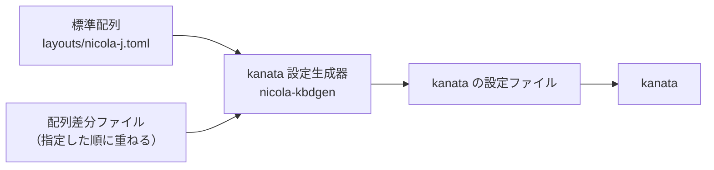

# 配列差分ファイル

この文書は、NICOLA の標準配列の一部を変更する配列差分ファイルを、同梱のものを含めて説明する。設定やコマンドの名前では、配列差分ファイルを overlay（標準配列に重ねるもの）と呼ぶ（`NICOLA_LAYOUT_OVERLAYS`、`--overlay`）。文字キー（配列で文字を割り当てたキー）以外のキーの再割り当ては、[設定リファレンス §3.2](settings.md#32-追加の-kanata-の設定ファイル)にある。

---

## 1. 仕組みと利用方法

配列差分ファイルは、標準配列（`layouts/nicola-j.toml`）のうち、変更する面だけを記述したファイル（TOML 形式）である。kanata-nicola は、kanata 設定生成器（`nicola-kbdgen`）で、標準配列に配列差分ファイルを重ねた配列から、kanata の設定ファイルを生成する。



重ねると、配列差分ファイルに記述した面だけが置き換わり、記述なしの面は元のまま残る。例えば、[§2](#2-書式) の例（Q キーの右親指の面を記述）を重ねると、Q キーの面は次のようになる。

| | 単独面 | 左親指の面 | 右親指の面 |
|---|---|---|---|
| 標準配列（Q キー） | 。 | ぁ | ゜ |
| 配列差分ファイル | （記述なし） | （記述なし） | **…** |
| 重ねた結果 | 。 | ぁ | **…** |

配列差分ファイルの指定と反映は、次のとおりである。

| 項目 | 内容 |
|---|---|
| 指定 | 設定 `NICOLA_LAYOUT_OVERLAYS` で指定する（[設定リファレンス §2](settings.md#2-設定項目)）。同梱のもの（[§3](#3-同梱の配列差分ファイル)）は名前で、利用者の配列差分ファイル（利用者が作成したもの）はファイル名で指定する（例: `NICOLA_LAYOUT_OVERLAYS=user-layout.toml`）。複数を指定した場合は、指定した順に重ねる。指定しない場合は、標準配列のまま |
| 置き場所 | 利用者の配列差分ファイルは、設定ファイル（`config.env`）と同じディレクトリに置く（パスの扱いは[設定リファレンス §1](settings.md#1-設定ファイル)） |
| 反映 | 常駐サービスは、起動のたびに kanata の設定ファイルを生成する。配列差分ファイルを更新した場合は、`systemctl --user restart kanata-nicola` で反映する |
| 誤りがある場合 | 生成時（常駐サービスでは起動時）にエラーとなる（対処は[導入と利用 §4](usage.md#4-トラブルへの対処)）。対象は、未知のキーコード名・項目、`[meta]`・`[keys.…]` 以外の表（`[key.…]` 等）、親指キー・NICOLA 切替キー・修飾キー・Ctrl として扱うキーに記述した面、記述できない値（[§2.2](#22-記述できない値)） |
| kanata 単体で使う場合 | kanata 設定生成器で `--overlay` を指定して、設定ファイルを再生成する（[kanata の設定ファイルの手引き §3](kanata-kbd.md#3-設定ファイルの再生成)）。`practical` と `lag-tolerant` を重ねたものは、生成済みのファイルがある（[kanata の設定ファイルの手引き §1.2](kanata-kbd.md#12-生成済みの設定ファイル)） |

## 2. 書式

次の例は、Q キーの右親指の面を `゜` から `…` に変更し、`@` キーの左右の親指の面に `←`・`→` を割り当てる。

```toml
[meta]
name = "user-layout"

[keys.KEY_Q]           # Q キー（D01）: 右親指の面を ゜ から … にする
right = "…"

[keys.KEY_LEFTBRACE]   # @ キー（D11）: 左親指の面を ←、右親指の面を → にする
left = "←"
right = "→"
```

コメントの D01 などは、キーの位置を表す JIS の位置記号（段の記号〔E＝数字段、D＝上段、C＝中段、B＝下段〕と列の番号）である。

記述する項目は、次のとおりである。

| 項目 | 内容 |
|---|---|
| `[meta]` | 任意。`name` に、配列差分ファイルの名前を記述する（kanata-nicola が生成する kanata の設定ファイルの、冒頭のコメントに記述される） |
| `[keys.<キーコード名>]` | 1 つのキーの面を記述する。キーは Linux のキーコード名で指定する。標準配列に無いキー（`^`・`¥` 等）も追加できる |
| `solo`・`left`・`right` | 単独面・左親指の面・右親指の面に記述する値（[§2.1](#21-面に記述する値)）。記述なしの面は、元の配列（標準配列と、先に重ねた配列差分ファイル）のまま |
| `pos` | 記述しなくてよい。キーの位置（JIS の位置記号）。生成する設定ファイルの中で、キーをキーボードの形に並べるためだけに使用し、入力には影響しない |

キーコード名は、記号のキーでは US 配列の刻印による名前なので、JIS の刻印と異なるものがある（JIS の `@` キーは `KEY_LEFTBRACE`、`[` キーは `KEY_RIGHTBRACE`）。標準配列のキーの名前は、`layouts/nicola-j.toml` で位置記号から調べられる。

### 2.1 面に記述する値

| 値 | 内容 |
|---|---|
| 文字（かな・記号） | その文字を入力する。送出の表（文字ごとに送出するキー列の表。IME〔Mozc〕の既定のローマ字表に合わせている）のキー列を送出する（`か` は `k a`、`→` は `z l`） |
| ローマ字（英数字・記号の ASCII だけで記述する） | 記述したとおりのキーを送出する（JIS 配列で、その文字を入力するキー。`?` は Shift+`/`）。入力される文字は、IME のローマ字表で決まる |
| 空の値 | その面を未定義にする。親指キーと組み合わせても、単独面の文字が入力される。3 面とも未定義にしたキーは、配列の対象外となり、キー本来の入力になる |

文字の例は [§2](#2-書式) にある。ローマ字と空の値は、次のように記述する。

```toml
[keys.KEY_6]          # E06
right = "z6"          # ローマ字: z と 6 を送出する。IME のローマ字表に登録した文字が入力される

[keys.KEY_SEMICOLON]  # C10
right = ""            # 空の値: 右の親指キーと組み合わせても、単独面の ん が入力される
```

- ローマ字は、IME のローマ字表に登録した項目を使用するためのもので、IME 側に登録したのと同じローマ字を記述する（例: IME のローマ字表に `z6` → `［` を登録し、面に `z6` と記述する）。IME の既定のローマ字表にあるローマ字も使用できる（`?` は `？`、`!` は `！` が入力される）。
- 同じキーで送出する文字（`、` と `，`、`。` と `．`、`／` と `・`）は、どちらを記述しても、入力される文字は IME の設定（句読点、記号の入力）で決まる。
- 送出の表のローマ字（`〜` の `z-` 等）を IME 側で変更している場合は、その面に IME 側のローマ字を記述する。

### 2.2 記述できない値

次の値は、kanata の設定ファイルの生成時にエラーとなる。

| 記述できない値 | 理由 |
|---|---|
| Shift が必要な文字（大文字、`*` `?` `!` 等）の後に、Shift が不要な文字を置いたもの（`*z`。`z*` は記述できる） | 1 つの面のキーは、同時に押して送出するため |
| 同じキーを 2 回使用するもの（`zz`、`:*`〔`:` と `*` は同じキー〕） | 同上 |
| 空白・制御文字 | 対応するキーが無い |
| 送出の表に無い文字（全角の `！`・`［`、`～`〔全角チルダ。表にあるのは波ダッシュ `〜`〕等） | 送出するキー列が無い。IME に入力するローマ字を記述する（`!` 等） |

濁点・半濁点（`゛` `゜`）だけの面は、ローマ字方式では送出できないが、標準配列にあるため、エラーにはならず、キー本来の入力になる（[設計書 §7.1](design.md#71-ローマ字方式)）。

## 3. 同梱の配列差分ファイル

標準配列の一部の配置を変更する調整として、次の 2 つを同梱している。

| 名前 | ファイル | 内容 | 指定の例 |
|---|---|---|---|
| `practical` | `layouts/overlays/practical.toml` | 使用頻度による配置の調整（`っ` を単独面へ移動する等。[§3.1](#31-practical使用頻度による配置の調整)） | `NICOLA_LAYOUT_OVERLAYS=practical` |
| `lag-tolerant` | `layouts/overlays/lag-tolerant.toml` | 離し遅れの対策（打鍵頻度の高いキーのシフト面を、単独面と同じ文字にする。[§3.2](#32-lag-tolerant離し遅れの対策)）。`practical` の上に重ねる | `NICOLA_LAYOUT_OVERLAYS=practical:lag-tolerant` |

- どちらも、標準配列と異なる配置になる。使用は任意で、既定では使用しない。
- 使用する場合は、設定ファイル（`config.env`）に「指定の例」のように記述する。

[§3.1](#31-practical使用頻度による配置の調整)・[§3.2](#32-lag-tolerant離し遅れの対策) の表のキーの位置は、JIS の位置記号（[§2](#2-書式)）で示す。

### 3.1 practical（使用頻度による配置の調整）

| キー（位置） | 面 | 標準 | practical | 理由 |
|---|---|---|---|---|
| `,`（B08） | 単独 | ね | っ | 使用頻度の高い `っ`（標準ではシフト面〔C10 の右親指〕）を単独面に置き、使用頻度の低い `ね` と入れ替える |
| `;`（C10） | 右親指 | っ | 未定義 | `っ` を B08 へ移動したため。右の親指キーと組み合わせると、単独面の `ん` が入力される |
| X（B02） | 左親指 | ー | ね | B08 から押し出された `ね` の移動先。`ー` は数字段の `-` キーで入力できる |
| P（D10） | 単独 | ， | 、 | 一般的な文章では `、` を使用することが多い。入力される文字は、どちらも IME の句読点の設定で決まる（[§2.1](#21-面に記述する値)） |
| `[`（D12） | 単独・右親指 | ゛・゜ | 未定義 | 濁点・半濁点だけの入力は、ローマ字方式では送出できず、キー本来の入力になる。濁音・半濁音は同時打鍵で入力する |
| `/`（B10） | 左親指 | ゛ | 未定義 | 同上 |
| Q（D01） | 右親指 | ゜ | 未定義 | 同上 |

D12 は 3 面とも未定義になるので配列の対象外となり、キー本来の `[` として入力される（IME で `「` になる）。

### 3.2 lag-tolerant（離し遅れの対策）

同時打鍵に使った親指キーを離すのがわずかに遅れると、次の文字が誤ってシフト面になる（離し遅れ。シフト残りとも言う）。例えば標準配列で「かくにん」と入力するとき、`に`（右の親指キー＋U）の親指キーを離す前に `ん`（`;` の単独面）を押すと、`;` の右親指の面 `っ` が入力され、「かくにっ」になる。kanata-nicola は、親指キーを押している間の文字をすべてシフト面にする（連続シフト）ため、離し遅れがとくに起きやすい。

`lag-tolerant` は、打鍵頻度の高い単独面を持つキーの**シフト面を単独面と同じ文字にする**。親指キーを離すのが遅れても、入力される文字が変わらない。シフト面から押し出された文字は、別のキーへ移動する（数字段の `『』` は移動せずに、未定義にする）。

上の例の `;`（C10）の右親指の面は、`practical` が `っ` を B08 へ移動して未定義にしている（単独面の `ん` が入力される）。そのため、`lag-tolerant` は `practical` の上に重ねる。

| キー（位置） | 標準（単独 / 左親指 / 右親指） | lag-tolerant | 備考 |
|---|---|---|---|
| C（B03） | す / ろ / ず | す / ろ / す | `ず` は B01 の右親指へ |
| L（C09） | い / ぽ / ょ | い / い / ょ | `ぽ` は B01 の単独へ |
| Z（B01） | ． / ぅ / 未定義 | ぽ / ぅ / ず | 押し出された `ぽ`・`ず` の移動先。`ぽ` はカタカナ語で使用頻度が高い。句点は D01 の `。` で入力する |
| `0`（E10） | 未定義 / 『 / 『 | 未定義 / 未定義 / 未定義 | E11 の `』` を未定義にするので、対の `『` も未定義にする |
| `-`（E11） | 未定義 / 』 / 』 | 未定義 / 未定義 / 未定義 | `ー`（`-` キー）はカタカナ語で使用頻度が高く、離し遅れで `』` になりやすい。`』` は使用頻度が低いので、移動しない |

E10・E11 は 3 面とも未定義になるので配列の対象外となり、親指キーと組み合わせても、キー本来の `0`・`-` として入力される（`-` は IME で `ー` になる）。数字段の単独面の「未定義」は、標準でもキー本来の入力（数字・`-`）である。
