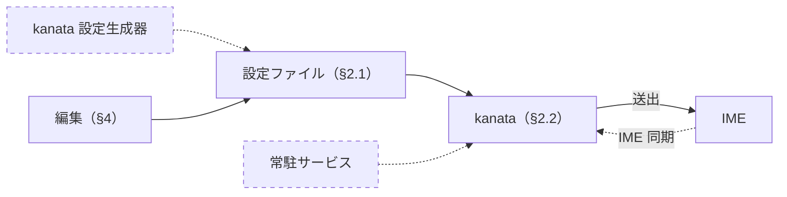

# Windows での利用

この文書は、Windows 11 で kanata-nicola を使用する方法と、Linux 版との違いを説明する。Windows は正式サポート前（試用は可能）である。

---

## 1. 対応の状況（Linux 版との比較）

Windows では、kanata-nicola を kanata 単体で使う（常駐サービスを使わず、kanata の Windows 版に、生成済みの設定ファイルを指定して起動する）。



破線は、Windows では未対応のもの（常駐サービス、IME 同期）と、未確認のもの（kanata 設定生成器での再生成。[§4](#4-設定の変更)）。

Linux 版（Ubuntu）と Windows 11 の対応の状況は、次の各節のとおり。

表の記号は、○ が使用できるもの（Windows では動作を確認したもの）、△ が条件つきで使用できるもの、× が未対応のもの、**未確認** が試していないもの。

### 1.1 入力の機能

| 機能 | Linux（Ubuntu） | Windows 11 |
|---|---|---|
| NICOLA の入力（[§2.2](#22-kanata-の起動と操作) の動作の確認） | ○ | ○ |
| JIS キーボードのキー（半角/全角・無変換・変換） | ○ | ○（生成済みの設定ファイルのキーの名前を、そのまま使用できる） |
| NICOLA 入力の ON/OFF（NICOLA 切替キーの方式。[§2.2](#22-kanata-の起動と操作)） | ○ | ○ |
| IME 同期（IME の状態に NICOLA の ON/OFF を合わせる） | ○（fcitx5＋Mozc） | × |
| IME | ○（fcitx5＋Mozc、ibus＋Mozc） | ○（Microsoft IME。z＋キーの記号は [§3](#3-制約と注意)）。Google 日本語入力（Mozc 系の IME）は **未確認** |

### 1.2 構成と運用

| 項目 | Linux（Ubuntu） | Windows 11 |
|---|---|---|
| kanata | 修正を適用した kanata（`install.sh` がビルドする） | リリースの実行ファイル（ビルド不要）。コンソール版の 1.12.0 で動作する。トレイに常駐する版は **未確認** |
| キー入力の取得と送出 | evdev・uinput | 標準の低水準キーボードフック（LLHOOK）と SendInput（追加のドライバは不要） |
| kanata の設定ファイル | 常駐サービスが、設定ファイル（`config.env`）と配列差分ファイルから、起動のたびに生成する | 生成済みの `kbd/` を使用する（[§2.1](#21-前提条件)）。変更の方法は [§4](#4-設定の変更) |
| インストール・アンインストール | `install.sh`・`uninstall.sh` | ×（[§2](#2-kanata-単体で使う方法) の手順で起動する） |
| 常駐・自動起動 | systemd のユーザサービス | ×（手動で起動する。タスク スケジューラでの自動起動は **未確認**。[§2.3](#23-ログオン時の自動起動)） |
| ログ | `journalctl` | kanata のコンソールの出力 |

### 1.3 動作範囲

| 状況 | Linux（Ubuntu） | Windows 11 |
|---|---|---|
| キーボードの抜き差し | ○（修正を適用した kanata） | ○（LLHOOK は個々のキーボードを取得しないため、影響を受けない）。Bluetooth キーボードは **未確認** |
| スリープからの復帰 | ○ | ○（Modern Standby 方式のスリープ）。休止状態からの復帰は **未確認** |
| 管理者の権限のウィンドウ | ○（権限による制限なし） | △（kanata を管理者の権限で起動した場合だけ。[§3](#3-制約と注意)） |

## 2. kanata 単体で使う方法

### 2.1 前提条件

- kanata の Windows 版（[kanata のリリース](https://github.com/jtroo/kanata/releases)の `windows-binaries-x64.zip`）のうち、コンソール版の `kanata_windows_tty_winIOv2_x64.exe`（標準の LLHOOK を使用するもの）を使用する。名前に `wintercept` の付くものは、Interception（キー入力を取得する追加のドライバ）用なので使用しない。
- このリポジトリを、`git clone` するか、GitHub のリポジトリのページの「Code」→「Download ZIP」でダウンロードして展開する。
- このリポジトリの `kbd/` の、配列プロファイル（kanata に指定するファイル。`nicola.kbd` または `nicola-lag-tolerant.kbd`）と、環境固有設定（`user-custom.kbd`。配列プロファイルが読み込む）を使用する（配列の違いは[kanata の設定ファイルの手引き §1.2](kanata-kbd.md#12-生成済みの設定ファイル)）。
- IME はローマ字入力にする（Microsoft IME の既定）。

### 2.2 kanata の起動と操作

リポジトリの直下で、配列プロファイルを指定して kanata を起動する（環境固有設定は、配列プロファイルと同じフォルダから読み込まれる）。

```powershell
<kanata のフォルダ>\kanata_windows_tty_winIOv2_x64.exe -c kbd\nicola.kbd
```

- NICOLA の ON/OFF は、NICOLA 切替キーの方式（半角/全角で、IME と一緒に切り替える。[導入と利用 §3.1](usage.md#31-nicola-入力の-onoff)）で行う。
- 停止するときは、kanata のウィンドウで Ctrl+C を入力するか、ウィンドウを閉じる。
- キーが意図しない動作をして、停止の操作ができないときは、**左Ctrl+Space+Esc**（kanata の標準の操作）で非常停止する。
- 動作の確認は、[導入と利用 §2.5](usage.md#25-動作の確認) の表の操作で行う（IME 同期の部分を除く）。

### 2.3 ログオン時の自動起動

**未確認:** タスク スケジューラで、ログオン時に [§2.2](#22-kanata-の起動と操作) のコマンドを実行するタスクを作成する（配列プロファイルはフルパスで指定する）。管理者の権限のウィンドウでも使用する場合は、「最上位の特権で実行する」にする（[§3](#3-制約と注意)）。

## 3. 制約と注意

Windows で kanata を使用するときは、次の点に注意する。

- **管理者の権限のウィンドウ:** 通常の権限の kanata は、管理者の権限で動作するウィンドウ（管理者のターミナル等）では機能せず、NICOLA で入力できない（Windows の権限の仕組みによる）。そこで使用するには、kanata を管理者の権限で起動する。
- **IME と NICOLA のずれ:** NICOLA 切替キーの方式は IME の実際の状態を見ないので、タスクバーのアイコンで IME を切り替えたときや、IME の状態の異なるウィンドウに切り替えたときに、IME と NICOLA がずれる。ずれたときは、タスクバーのアイコン等で IME だけを切り替えて、NICOLA に合わせる（半角/全角は両方を切り替えるので、ずれは解消しない）。
- **z＋キーの記号:** `〜`（`z-`）・`『`（`z[`）・`』`（`z]`）は Mozc 系の IME のローマ字で、Microsoft IME では z と記号がそのまま入力される。これらの記号を使用する場合は、Google 日本語入力（ローマ字表が Mozc と同じ。**未確認**）にするか、配列プロファイルの面の文字を、Microsoft IME で入力できる文字に変更する（[kanata の設定ファイルの手引き §2.2](kanata-kbd.md#22-文字の割り当ての変更)）。
- **kanata のログ:** Ctrl＋変換などの後に、`Unexpected keycode is pressed in kanata but not in Windows. Clearing kanata states` と表示されることがある。IME が処理したキーを Windows が押されていないものとして扱い、kanata が保持している押下の状態を消去したことを示す。確認した範囲（Ctrl を押したままの連打等）では、入力への影響はない。

## 4. 設定の変更

Linux 版（Ubuntu）と Windows 11 で、設定を変更する方法は、次のとおり（記号は [§1](#1-対応の状況linux-版との比較) と同じ）。

| 方法 | Linux（Ubuntu） | Windows 11 | 備考 |
|---|---|---|---|
| 環境固有設定・配列プロファイルの編集 | ○（kanata 単体で使う場合） | ○ | リポジトリの外にコピーして編集し、起動するときは、コピーした配列プロファイルを指定する（[§2.2](#22-kanata-の起動と操作)。編集の方法は[kanata の設定ファイルの手引き §2](kanata-kbd.md#2-設定ファイルの編集)） |
| 配列差分ファイル・kanata 設定生成器（`nicola-kbdgen`）のオプション | ○ | **未確認** | 再生成に、kanata 設定生成器のビルド（Rust）が必要である。OS に依存しない作りだが、Windows でのビルドを試していない。Linux で再生成した設定ファイルを、コピーして使用することもできる（再生成の方法は[kanata の設定ファイルの手引き §3](kanata-kbd.md#3-設定ファイルの再生成)） |
| 設定ファイル（`config.env`） | ○ | × | 常駐サービス（`platform/linux/` のスクリプト）が読み込むファイルである |
